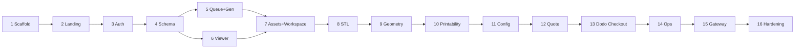

# PrintForge — Implementation Plan v2 (Executor Edition)

**Source spec:** `PrintForge_PRD.md` (v1.0, 19 July 2026)
**Plan authored by:** Claude Fable 5, 19 July 2026
**Plan executed by:** Claude Opus 4.8 (or any later model), across sixteen 5-hour sessions
**Payments:** Dodo Payments (Merchant of Record) — replaces the PRD's Stripe suggestion because the business operates from India, where Stripe is unavailable.
**Launch defaults:** India, INR (integer paise), GST-inclusive pricing placeholders.

This document is written to be executed mechanically. All architectural judgment has already been exercised here; the executing model should implement, not redesign. Section 4 defines normative contracts (types, state machines, adapter interfaces, schema, API surface). Section 6 defines the sixteen sessions. When this plan and the PRD appear to conflict, this plan wins (it encodes deliberate, documented deviations).

---

## 0. Executor protocol — read this at the start of EVERY session

1. **Resume:** Read §9 (session log) to find the next unchecked session. Read that session's spec in §6 fully before writing any code. Read `DECISIONS.md` at repo root if it exists.
2. **Verify before building:** Run `npm run verify` (typecheck + lint + unit tests with coverage + build). It must be green before new work starts. If it is not green, fixing it is the first task of the session.
3. **Do not redesign.** Do not substitute libraries, rename the contracts in §4, restructure directories, or "improve" the architecture. If something in §4 is genuinely impossible as written (e.g., an external API changed), implement the closest equivalent **inside the affected adapter only**, keep the interface identical, and append an entry to `DECISIONS.md`: date, what changed, why, files touched.
4. **External API drift rule:** Before implementing a *real* adapter (Meshy in S5, Dodo in S13, OctoPrint in S15), fetch the provider's current docs (URLs given in the session) and confirm endpoint/field names. The internal interfaces in §4.4 do not change regardless of what you find; only the adapter internals may differ from this plan's sketch.
5. **Coverage is law.** `vitest.config.ts` thresholds stay at 100/100/100/100. Never lower them, never broaden the exclusion list beyond §5.1, never add `istanbul ignore` without a justification comment on the same line. If coverage fails, write the missing test — do not delete code paths to dodge it unless the code is genuinely dead.
6. **Tests ship with code in the same commit.** Never commit source without its tests.
7. **Cut line:** Each session's **Definition of done** is the cut line. If time runs out, stop at a green state, check off what's done, and write the carry-over as the first task of the next session in §9. Never end mid-refactor or with failing tests.
8. **End of session:** `npm run verify` green → Playwright green (`npm run e2e`) → update §9 session log (date, shipped, carry-overs) → commit. Commit messages: `S<nn>: <imperative summary>`.
9. **Ambiguity rule:** If §6 is silent on a detail, choose the simplest implementation that satisfies the session's test checklist and Definition of done, matching existing code style. Do not ask the user mid-session for anything already covered by §8's placeholder convention — use a labelled placeholder instead.
10. **Never** put provider secrets in client components/bundles, trust client-submitted prices, or mutate a stored mesh asset in place. These three are recurring PRD invariants; CI asserts them from S13/S15 onward.

---

## 1. Guiding principles

1. **Every session ends green and committed.**
2. **Tests are written with the code, not after** — 100% statement/branch/function/line coverage enforced from Session 1 so debt cannot accumulate.
3. **Adapters at every external boundary** (Meshy, Dodo, Supabase, slicer, printer gateway, email, scanner, moderation). Each has a typed interface, a real implementation, and an in-repo mock. The whole product runs and demos with zero external credentials; env vars flip mocks to real.
4. **Server is the source of truth** for prices, quotes, states, and dispatch. The client renders state, never asserts it.
5. **Unknown business values are isolated** in `src/config/` with `// OWNER DECISION REQUIRED` labels (see §8).
6. **State machines over booleans** — six explicit machines (§4.3) with exhaustively tested transition tables.
7. **Pure domain core:** `src/domain/` imports nothing from Next.js, Supabase, or the network. Route/worker handlers are thin: parse → authorize → call domain/adapters → persist → respond.

---

## 2. Tech stack (locked)

| Layer | Choice | Notes |
|---|---|---|
| Framework | Next.js 15+ (App Router) + TypeScript `strict` | One deployable: landing, app, BFF API routes, ops dashboard |
| UI | Tailwind CSS v4 + shadcn/ui (Radix primitives) | Vendored components are covered by tests like all other source |
| 3D | React Three Fiber + Drei + Three.js | GLB viewer; Visual Mode + Technical Mesh View |
| Auth / DB / Storage | Supabase (Auth, Postgres + RLS, private Storage buckets) | Accessed only through `src/data/` repositories and `src/adapters/` |
| **Payments** | **Dodo Payments** (Merchant of Record) via `dodopayments` npm SDK + `standardwebhooks` for signature verification | Behind `PaymentProvider` adapter; INR; test mode until launch. See §2.2 |
| AI generation | Meshy behind `GenerationProvider` adapter | `MockGenerationProvider` ships bundled sample GLBs |
| Geometry & slicing | TypeScript Node workers behind `GeometryAnalyzer`/`Slicer` adapters | Deviation from PRD's Python suggestion — §2.1 |
| Queue | Postgres-backed durable `jobs` table + worker loop | Deviation from Redis/Celery — §2.1 |
| Unit/component tests | Vitest + @vitest/coverage-v8 + @testing-library/react + vitest-axe + MSW | Thresholds 100/100/100/100 |
| 3D tests | @react-three/test-renderer + pure-logic extraction | §5.4 |
| E2E | Playwright | Golden journeys + failure paths |
| CI | GitHub Actions | typecheck → lint → unit+coverage → build → e2e |

### 2.1 Deliberate deviations from the PRD's suggested architecture

- **Dodo Payments replaces Stripe.** Stripe does not onboard India-based merchants; Dodo is an India-friendly Merchant of Record with hosted checkout and Standard-Webhooks-signed events, preserving the PRD's integrity requirements (server-created sessions, verified webhooks, idempotency). As MoR, Dodo also owns tax collection on the transaction. ⚠️ Owner must confirm with Dodo that **physical goods** (custom 3D prints) are permitted under their MoR terms — §8 item 5.
- **TypeScript workers instead of Python/FastAPI.** One language → one test toolchain → sustainable 100% coverage. Geometry checks are implemented on indexed triangle meshes in pure TS. The `GeometryAnalyzer`/`Slicer` contracts are transport-agnostic; a Python/trimesh/PrusaSlicer service can replace the Node implementation later without touching the app.
- **Postgres job queue instead of Redis + Celery.** A `jobs` table with `FOR UPDATE SKIP LOCKED`, retries, and dead-letter status meets the PRD's durability/idempotency bar with no extra infrastructure; swappable behind `JobQueue`.
- **Real slicing via PrusaSlicer CLI wrapper, mocked by default.** `MockSlicer` returns deterministic volume-derived estimates so quoting is fully testable; the CLI implementation activates when hardware decisions exist.

### 2.2 Dodo Payments integration facts (verified against docs, 19 July 2026 — re-verify at Session 13 start)

- SDK: `npm i dodopayments standardwebhooks`. Client: `new DodoPayments({ bearerToken: env.DODO_API_KEY, environment: 'test_mode' | 'live_mode' })`.
- Checkout: `client.checkoutSessions.create({ product_cart, customer, billing_address, return_url, metadata })` → `{ session_id, checkout_url }`. The `checkout_url` is **single-use** and expires within 24 h.
- **Server-defined amounts:** Dodo prices come from catalog products. To charge a per-quote computed price, the owner creates ONE catalog product ("Custom 3D Print") with **"pay what you want" enabled**; the adapter passes the server-calculated total as the item's `amount` (minor units) in `product_cart`. Product id lives in `DODO_PRODUCT_ID` env var.
- Webhooks follow the **Standard Webhooks** spec: headers `webhook-id`, `webhook-timestamp`, `webhook-signature`; verify with `new Webhook(env.DODO_WEBHOOK_SECRET).verify(rawBody, headers)` from `standardwebhooks`. **The raw request body string must be used** — in a Next.js route handler read `await req.text()` before any JSON parsing.
- Event payloads carry `type` (e.g. `payment.succeeded`, `payment.failed`, `refund.succeeded`, `dispute.*`), an ISO timestamp, and a `data` object; `metadata` set at checkout comes back on payment events — we carry `quote_id` and `order_id` there.
- Docs to re-check in S13: <https://docs.dodopayments.com/developer-resources/checkout-session> and <https://docs.dodopayments.com/developer-resources/webhooks>.

---

## 3. Repository structure

Create exactly this layout (files appear in their designated session; don't pre-create empty stubs):

```
printforge/
├── app/
│   ├── (marketing)/page.tsx                 # S2 landing
│   ├── (auth)/{sign-up,login,reset-password,profile}/page.tsx   # S3
│   ├── (studio)/
│   │   ├── projects/page.tsx                # S4 list
│   │   ├── projects/[projectId]/page.tsx    # S7 creator workspace
│   │   ├── checkout/[quoteId]/page.tsx      # S13
│   │   └── orders/{page.tsx,[orderId]/page.tsx}  # S13
│   ├── (ops)/ops/{page.tsx,orders/[orderId]/page.tsx,reviews/page.tsx,printers/page.tsx}  # S14–15
│   └── api/
│       ├── projects/route.ts                            # S4  POST/GET
│       ├── projects/[id]/generations/route.ts           # S5  POST
│       ├── generations/[id]/route.ts                    # S5  GET
│       ├── design-versions/[id]/configuration/route.ts  # S11 POST
│       ├── design-versions/[id]/quote/route.ts          # S12 POST
│       ├── uploads/stl/route.ts                         # S8  POST
│       ├── checkout/session/route.ts                    # S13 POST
│       ├── orders/[id]/route.ts                         # S13 GET
│       ├── ops/…                                        # S14–15 (role-gated)
│       └── webhooks/{dodo,generation-provider}/route.ts # S13, S5
├── src/
│   ├── components/         # ui/ (shadcn) + app components per feature
│   ├── viewer/             # logic/ (pure) + canvas/ (R3F) + controls/ (DOM)
│   ├── domain/
│   │   ├── stateMachines/  # generation.ts validation.ts quote.ts order.ts payment.ts printJob.ts machine.ts
│   │   ├── geometry/       # mesh.ts manifold.ts components.ts normals.ts intersect.ts measure.ts stlParse.ts
│   │   ├── printability/   # report.ts thresholds.ts
│   │   ├── pricing/        # engine.ts rules.ts
│   │   └── quoting/        # quote.ts invalidation.ts
│   ├── adapters/           # one dir per boundary: index.ts (interface) + <real>.ts + mock.ts + contract.spec-factory.ts
│   │   ├── generation/  payments/  slicer/  printerGateway/
│   │   ├── storage/  email/  moderation/  scanner/  auth/
│   ├── data/               # repositories: projects.ts designVersions.ts assets.ts validationReports.ts
│   │                       #   configurations.ts quotes.ts orders.ts printJobs.ts printers.ts shipments.ts
│   │                       #   auditEvents.ts notificationLog.ts webhookEvents.ts jobs.ts profilesRepo.ts
│   ├── jobs/               # queue.ts worker.ts handlers/{generation,ingestion,validation,slicing,dispatch}.ts
│   ├── config/             # env.ts commerce.ts profiles.ts content.ts pricingRules.ts
│   └── lib/                # result.ts money.ts ids.ts errors.ts logger.ts clock.ts rateLimit.ts
├── supabase/{migrations/,seed.sql}
├── scripts/worker.ts       # long-running worker entrypoint (dev: run beside next dev)
├── tests/
│   ├── e2e/                # Playwright specs
│   └── fixtures/           # models/ (GLB+STL, valid+broken), dodo/ (webhook payloads), meshy/ (API payloads)
├── DECISIONS.md            # created on first deviation
├── vitest.config.ts  playwright.config.ts  .env.example
└── .github/workflows/ci.yml
```

---

## 4. Normative contracts

These are binding. Sessions reference them instead of re-specifying.

### 4.1 Coding conventions

- **Result type** (`src/lib/result.ts`): `type Result<T, E = AppError> = { ok: true; value: T } | { ok: false; error: E }` with helpers `ok()`, `err()`, `mapResult()`, `unwrapOr()`. Domain functions and adapters return `Result`; they do not throw for expected failures. Route handlers convert `Result` errors to HTTP responses via one shared `toHttpError()`.
- **Errors** (`src/lib/errors.ts`): `class AppError { code: ErrorCode; message: string; cause?: unknown }` with `ErrorCode` union: `'validation' | 'unauthorized' | 'forbidden' | 'not_found' | 'conflict' | 'rate_limited' | 'provider_error' | 'precondition_failed' | 'internal'`. HTTP mapping: 400, 401, 403, 404, 409, 429, 502, 412, 500 respectively.
- **Money** (`src/lib/money.ts`): `type Money = { amountMinor: number; currency: 'INR' }` — integer paise only. Functions: `addMoney`, `multiplyMoney(m, factor)` (round half-up), `percentOf(m, bps)` (basis points, round half-up), `formatINR` (`₹1,234.50`, Indian digit grouping), `assertMoneyInvariant` (integer, non-negative, INR). Any float in `amountMinor` is a thrown invariant violation (programmer error, not a Result).
- **IDs** (`src/lib/ids.ts`): prefixed IDs `proj_`, `dv_`, `ast_`, `vr_`, `cfg_`, `qt_`, `ord_`, `pj_`, `shp_`, `job_`, `ntf_` + 26-char Crockford ULID. `newId(prefix)`, `isId(prefix, s)`.
- **Clock/randomness** (`src/lib/clock.ts`): `Clock` interface (`now(): Date`) injected everywhere time matters (quote expiry, webhook tolerance, job backoff) so tests control it. Never call `Date.now()` in domain code.
- **Validation:** every route parses input with a zod schema defined next to the route; parse failure → `validation` error. Never access `req.body`/params untyped.
- **Server-only guard:** modules holding secrets or privileged logic (`src/adapters/*/[real].ts`, `src/jobs/**`, `src/data/**`) import the `server-only` package as their first import.

### 4.2 Core domain types (`src/domain/types.ts`, grown across sessions)

```ts
type Role = 'customer' | 'operator' | 'admin';
type DesignSource = 'generated' | 'uploaded';
type AssetType = 'model_glb' | 'model_stl' | 'model_3mf' | 'thumbnail' | 'gcode' | 'reference_image';
type Verdict = 'pass' | 'warning' | 'manual_review' | 'fail';
type FindingKind =
  | 'non_manifold_edges' | 'boundary_holes' | 'self_intersections' | 'inverted_normals'
  | 'multiple_components' | 'degenerate_geometry' | 'empty_mesh'
  | 'exceeds_build_volume' | 'below_min_wall' | 'unsupported_overhang' | 'unstable_base' | 'trapped_volume';
interface Finding { kind: FindingKind; severity: 'info' | 'warning' | 'blocking'; detail: string; count?: number }
interface Measurements {
  boundingMm: { x: number; y: number; z: number };
  volumeCm3: number; surfaceAreaCm2: number; triangleCount: number; componentCount: number;
}
interface StructuredBrief {           // zod-schema'd in S7
  intendedUse: string; approxSizeMm: number; style: string;
  durability: 'display' | 'everyday' | 'reinforced';
  materialPref?: string; colorPref?: string; rawPrompt: string;
}
interface QuoteBreakdownLine { key: string; label: string; amount: Money }  // keys fixed in §6 S12
```

### 4.3 State machines — full transition tables

Implement one generic helper `src/domain/stateMachines/machine.ts`:
`defineMachine<S extends string, E extends string>(table: Record<S, Partial<Record<E, S>>>)` returning `{ can(s,e): boolean; next(s,e): Result<S>; states, events }`. `next` on an illegal pair returns `err(conflict)`. Every writer of a state column calls `next()`; nothing assigns states directly. Each machine's spec enumerates the **full S×E matrix** (legal transitions asserted; every illegal pair asserted as error).

**Generation** — states `queued | creating | ready | failed`
| From \ Event | PROVIDER_ACCEPTED | PROVIDER_COMPLETED | PROVIDER_FAILED | RETRY |
|---|---|---|---|---|
| queued | creating | — | failed | — |
| creating | — | ready | failed | — |
| failed | — | — | — | queued |
| ready | — | — | — | — |

**Validation** — states `pending | analyzing | pass | warning | manual_review | fail`
Events: `START` (pending→analyzing), `RESULT_PASS|RESULT_WARNING|RESULT_MANUAL|RESULT_FAIL` (analyzing→respective terminal), `REVALIDATE` (any terminal→pending). Operator override: `OPERATOR_APPROVE` (manual_review→pass, records AuditEvent), `OPERATOR_REJECT` (manual_review→fail).

**Quote** — states `active | expired | superseded | consumed`
Events: `EXPIRE` (active→expired, clock-driven), `SUPERSEDE` (active→superseded, on any pricing-relevant change §6-S12), `CONSUME` (active→consumed, at successful checkout creation). Terminal states accept nothing.

**Order (fulfillment)** — states `pending_payment | paid | design_review | production_queued | printing | quality_check | shipped | delivered | on_hold | cancelled`
| Event | From → To |
|---|---|
| PAYMENT_CONFIRMED | pending_payment → paid |
| PAYMENT_FAILED | pending_payment → cancelled |
| ENTER_REVIEW (auto after paid) | paid → design_review |
| APPROVE (auto if validation=pass, else operator) | design_review → production_queued |
| REJECT (operator, triggers refund) | design_review → cancelled |
| PRINT_STARTED | production_queued → printing |
| PRINT_COMPLETED | printing → quality_check |
| PRINT_FAILED (retry keeps state) | printing → production_queued |
| QC_PASSED + tracking added | quality_check → shipped |
| QC_FAILED (reprint) | quality_check → production_queued |
| DELIVERED (carrier/webhook/manual) | shipped → delivered |
| HOLD / RELEASE_HOLD (operator, any state paid..quality_check) | X → on_hold → back to X (store `held_from_status`) |
| CANCEL (operator, any state paid..quality_check; triggers refund) | X → cancelled |

Customer-visible labels map: paid→"Paid — preparing for production", design_review→"Design review", production_queued→"Queued", printing→"Printing", quality_check→"Quality check", shipped→"Shipped", delivered→"Delivered".

**Payment (independent axis on Order)** — `unpaid | paid | partially_refunded | refunded`
Events: `PAYMENT_SUCCEEDED` (unpaid→paid), `REFUND_PARTIAL` (paid→partially_refunded, partially_refunded→partially_refunded), `REFUND_FULL` (paid|partially_refunded→refunded). Kept separate from fulfillment per FR-7.

**PrintJob** — `pending | released | printing | completed | failed | cancelled`
Events: `RELEASE` (pending→released), `STARTED` (released→printing), `COMPLETED` (printing→completed), `FAILED` (released|printing→failed), `RETRY` (failed→pending), `CANCEL` (pending|released|printing→cancelled). `RELEASE` additionally requires the dispatch preconditions guard (§6-S15) — guard failure is `precondition_failed`, not a transition error.

### 4.4 Adapter interfaces (each in `src/adapters/<name>/index.ts`)

```ts
// generation
interface GenerationProvider {
  submit(brief: StructuredBrief): Promise<Result<{ providerTaskId: string }>>;
  poll(providerTaskId: string): Promise<Result<GenerationStatus>>;
  parseWebhook?(rawBody: string, headers: Record<string,string>): Result<GenerationStatus>;
}
type GenerationStatus =
  | { state: 'queued' | 'creating'; progressPct?: number }
  | { state: 'ready'; assets: { glbUrl: string; stlUrl?: string } }
  | { state: 'failed'; reason: string };

// payments
interface PaymentProvider {
  createCheckout(input: {
    quoteId: string; orderId: string; amount: Money;
    customer: { email: string; name: string };
    returnUrl: string; metadata: Record<string, string>;
  }): Promise<Result<{ providerSessionId: string; checkoutUrl: string }>>;
  verifyAndParseWebhook(rawBody: string, headers: Record<string, string>): Result<PaymentEvent>;
  createRefund(paymentRef: string, amount?: Money): Promise<Result<{ refundRef: string }>>;
}
type PaymentEvent =
  | { type: 'payment.succeeded'; eventId: string; paymentRef: string; metadata: Record<string,string>; amount: Money }
  | { type: 'payment.failed';    eventId: string; metadata: Record<string,string>; reason: string }
  | { type: 'refund.succeeded';  eventId: string; paymentRef: string; amount: Money }
  | { type: 'dispute.opened';    eventId: string; paymentRef: string }
  | { type: 'ignored';           eventId: string; rawType: string };   // unknown types are logged, ACKed, ignored

// slicer
interface Slicer {
  slice(input: { meshStorageKey: string; scaleFactor: number;
    printerProfileId: string; materialId: string; qualityId: string; strengthId: string;
  }): Promise<Result<SliceResult>>;
}
interface SliceResult {
  durationMinutes: number; materialGrams: number; materialMeters: number;
  supportsUsed: boolean; gcodeStorageKey: string;
  slicerVersion: string; profileVersion: string; orientation: { rx: number; ry: number; rz: number };
}

// printer gateway
interface PrinterGateway {
  release(job: { printJobId: string; printerId: string; gcodeStorageKey: string; idempotencyKey: string }): Promise<Result<{ gatewayJobRef: string }>>;
  printerStatus(printerId: string): Promise<Result<{ state: 'idle'|'busy'|'offline'|'error'; currentJobRef?: string; progressPct?: number }>>;
  cancel(gatewayJobRef: string): Promise<Result<void>>;
}

// storage
interface AssetStorage {
  ingestFromUrl(url: string, opts: { keyPrefix: string; expectedMime: string; maxBytes: number }): Promise<Result<StoredAsset>>;
  put(bytes: Uint8Array, opts: { keyPrefix: string; mime: string }): Promise<Result<StoredAsset>>;
  getSignedUrl(storageKey: string, ttlSeconds: number): Promise<Result<string>>;
  read(storageKey: string): Promise<Result<Uint8Array>>;   // workers only
}
interface StoredAsset { storageKey: string; checksumSha256: string; bytes: number; mime: string }

// email
interface Notifier { send(input: { to: string; template: TemplateKey; data: Record<string, unknown>; orderId?: string }): Promise<Result<{ messageRef: string }>> }
type TemplateKey = 'order_receipt' | 'review_hold' | 'production_milestone' | 'shipment' | 'cancellation_refund' | 'ops_manual_review' | 'ops_print_failure';

// moderation & scanning
interface Moderator { check(input: { text?: string; imageBytes?: Uint8Array }): Promise<Result<{ verdict: 'allow'|'deny'|'flag'; category?: string }>> }
interface UploadScanner { scan(bytes: Uint8Array): Promise<Result<{ clean: boolean; threat?: string }>> }

// queue
interface JobQueue {
  enqueue(input: { type: JobType; payload: unknown; idempotencyKey: string; runAt?: Date; maxAttempts?: number }): Promise<Result<{ jobId: string; deduped: boolean }>>;
  claimNext(workerId: string, types: JobType[]): Promise<Result<ClaimedJob | null>>;
  complete(jobId: string): Promise<Result<void>>;
  fail(jobId: string, error: string, opts: { retryable: boolean }): Promise<Result<void>>;  // schedules retry w/ backoff or dead-letters
  heartbeat(jobId: string): Promise<Result<void>>;
}
type JobType = 'generation.submit' | 'generation.poll' | 'asset.ingest' | 'validation.run' | 'slicing.run' | 'print.dispatch' | 'notification.send';
```

Every adapter dir also exports `contractSpecFactory(makeImpl)` — a shared Vitest suite run against **both** mock and real (real behind MSW/fixtures) so they can never drift.

### 4.5 Database schema (Supabase migrations; all tables `id text pk` using §4.1 prefixed ids unless noted)

| Table | Columns (beyond id, created_at, updated_at) | Notes |
|---|---|---|
| profiles | user_id uuid FK auth.users UNIQUE, role role_enum default 'customer', name, email | role changed only by admin (RLS) |
| projects | user_id, title, status ('active'\|'archived') | |
| design_versions | project_id, source design_source_enum, version_no int, prompt text NULL, brief_json jsonb, provider_task_id text NULL, glb_asset_id, stl_asset_id, thumbnail_asset_id, generation_status text | **Immutable after creation** (trigger rejects UPDATE except generation_status/asset ids while status ≠ ready) |
| assets | type asset_type_enum, storage_key UNIQUE, checksum_sha256, bytes, mime, source_asset_id NULL | |
| validation_reports | design_version_id, printer_profile_id text, status text, findings_json jsonb, measurements_json jsonb | one active per (dv, profile, scale-hash) |
| print_configurations | design_version_id, material_id, color_id, dimensions_mm jsonb {x,y,z}, scale_factor numeric, quality_id, strength_id, shipping_speed, special_instructions | |
| quotes | configuration_id, status text, amount_minor bigint, currency char(3), breakdown_json jsonb, slice_json jsonb, expires_at timestamptz | |
| orders | user_id, quote_id UNIQUE, status text, payment_status text, held_from_status text NULL, contact_json jsonb, shipping_address_json jsonb, provider_session_id text NULL, payment_ref text NULL, frozen_dv_id, frozen_config_json jsonb | freeze at order creation (FR-2) |
| print_jobs | order_id, printer_id NULL, status text, gcode_asset_id NULL, slice_json jsonb, gateway_job_ref NULL, failure_reason NULL, attempt int default 0 | |
| printers | name, gateway_kind, capabilities_json, current_state, last_seen_at | seeded from config |
| shipments | order_id, carrier, tracking_number, status | |
| audit_events | actor_id NULL, actor_kind ('user'\|'system'), entity_type, entity_id, action, metadata jsonb | **INSERT-only** (trigger blocks UPDATE/DELETE) |
| jobs | type, payload jsonb, status ('pending'\|'running'\|'done'\|'failed'\|'dead'), idempotency_key UNIQUE, attempts int, max_attempts int default 5, run_at, locked_by NULL, locked_at NULL, last_error NULL | claim via `FOR UPDATE SKIP LOCKED` |
| webhook_events | provider, event_id, received_at, payload jsonb, processing_result | UNIQUE(provider, event_id) → idempotency |
| notification_log | order_id NULL, to_email, template, status, message_ref, error NULL | |
| rate_limits | key text PK, window_start timestamptz, count int | fixed-window per user+action |

**RLS matrix:** customers: SELECT/INSERT/UPDATE own rows on projects, design_versions (via project), print_configurations, orders (SELECT only after creation), shipments (SELECT via order); no access to jobs, printers, audit_events, webhook_events, other users' anything. operators/admins: SELECT all domain tables; UPDATE only via service-role server routes (ops API), never direct. All storage buckets private; access via signed URLs only.

### 4.6 API surface (all JSON; auth = Supabase session unless noted; every handler: zod-parse → authz → domain → respond)

| Route | Method | Auth | Purpose / notes |
|---|---|---|---|
| /api/projects | POST, GET | customer | create {title}; list own |
| /api/projects/[id]/generations | POST | customer+owner | body: brief fields; moderation gate; rate limit 5/hour/user → 429; enqueues `generation.submit` |
| /api/generations/[id] | GET | customer+owner | normalized {status, progressPct?, designVersionId?} — never provider fields |
| /api/uploads/stl | POST | customer | multipart; ≤50 MB; .stl only; scanner gate; → DesignVersion(source uploaded) + `validation.run` |
| /api/design-versions/[id]/configuration | POST | customer+owner | validates against §4.5 profiles; persists; triggers re-validation if scale changed |
| /api/design-versions/[id]/quote | POST | customer+owner | requires configuration + validation ∈ {pass, warning}; enqueues `slicing.run` if no fresh slice; returns quote (may be `pending_slice` interim) |
| /api/checkout/session | POST | customer+owner | body {quoteId} ONLY — server rereads amount; quote must be active+unexpired; creates order (pending_payment) + Dodo session; CONSUMEs quote |
| /api/orders, /api/orders/[id] | GET | customer+owner | status timeline (customer-visible labels), thumbnail, frozen config, shipment tracking |
| /api/ops/orders | GET | operator | filters: status, printer, material, due, exception |
| /api/ops/orders/[id]/review | POST | operator | {action: approve\|reject\|hold\|release_hold, reason: required} → AuditEvent |
| /api/ops/print-jobs/[id]/{assign,release,retry,cancel,qc} | POST | operator | §6-S14/S15; release runs precondition guard |
| /api/ops/orders/[id]/shipment | POST | operator | {carrier, trackingNumber} → shipped |
| /api/webhooks/dodo | POST | signature | raw-body verify → PaymentEvent → idempotent processing (§6-S13) |
| /api/webhooks/generation-provider | POST | signature/secret | optional Meshy completion push; same normalization as poll |

Public/auth/generation/upload routes are rate-limited via `src/lib/rateLimit.ts` (fixed window on the `rate_limits` table).

### 4.7 Domain events → implementation

The PRD §13 event list is realized as: (a) state-machine transitions persisted on entities, (b) an `audit_events` row per transition, (c) follow-on `jobs` enqueued transactionally with the state write (same Postgres transaction — this is the outbox; the worker loop is the dispatcher).

---

## 5. Testing rules — how 100% stays real

### 5.1 Enforcement config

`vitest.config.ts`: `coverage: { provider: 'v8', all: true, include: ['app/**', 'src/**'], exclude: [<generated-only list>], thresholds: { statements: 100, branches: 100, functions: 100, lines: 100 } }`. The ONLY allowed exclusions: `**/*.d.ts`, `app/**/layout.tsx` metadata-only exports, `playwright.config.ts`, `scripts/worker.ts` bootstrap (its logic lives in `src/jobs/worker.ts`, which IS covered). This list may not grow without a `DECISIONS.md` entry.

### 5.2 Layer rules

- **Domain/lib:** exhaustive — every branch, every state×event pair, every pricing rule and rounding edge (0, 1 paise, half-up boundary), every geometry check against every relevant fixture.
- **Components:** render + every prop variant + user interaction (click AND keyboard) + `expect(await axe(container)).toHaveNoViolations()`.
- **Routes:** per handler: unauthenticated 401 → wrong-owner 403 → invalid body 400 → happy path → each domain error mapping. Use in-memory adapters + repository stubs; plus thin integration specs against local Supabase for RLS-sensitive paths (S3/S4).
- **Adapters:** contract suite against mock AND real (real via MSW fixtures in `tests/fixtures/<provider>/`).
- **State writers:** any function that persists a state change has a test proving it refuses an illegal transition.

### 5.3 Naming & placement

`<file>.test.ts(x)` colocated next to source. E2E: `tests/e2e/<flow>.spec.ts`. Fixtures documented in `tests/fixtures/README.md` with provenance and hand-computed expected values.

### 5.4 The 3D canvas strategy

All viewer logic is pure and lives in `src/viewer/logic/` (unit-tested): `viewerReducer(state, action)` (mode, overlays, fullscreen, selection), `fitCameraToBounds(bounds, fovDeg) → {position, target}`, `computeDimensionsMm(bounds, scaleFactor)`, `screenshotFileName(projectTitle, clock)`. Canvas components in `src/viewer/canvas/` are thin and tested with `@react-three/test-renderer` (assert: mesh material type per mode, wireframe flag, helpers present/absent, props plumbed). DOM controls in `src/viewer/controls/` are ordinary Testing Library targets. Playwright asserts canvas mount + state via `data-viewer-mode` attributes, never pixels.

### 5.5 Session ritual

Documented once here, applies to every session: start `npm run verify` → build in vertical slices (code+tests) → end `npm run verify` + `npm run e2e` → update §9 → commit.

---

## 6. Session plan

---

### Session 1 — Scaffold, toolchain, coverage gate, CI

**Objective:** Running Next.js app with the 100% gate enforced and CI live.
**Prereqs:** none.

**Steps**
1. *(45m)* `npx create-next-app@latest printforge` (App Router, TS, Tailwind, ESLint, `src/` NO — use layout in §3). Enable `strict`, `noUncheckedIndexedAccess`, `exactOptionalPropertyTypes` in tsconfig. `shadcn init` (Radix, neutral base). Prettier + import sorting.
2. *(60m)* `src/lib/`: implement `result.ts`, `errors.ts` (+`toHttpError`), `money.ts`, `ids.ts`, `clock.ts` (`SystemClock`, `FixedClock`), `logger.ts` (leveled, JSON in prod, silent in test) — exactly per §4.1.
3. *(40m)* `src/config/env.ts`: zod schema for ALL env vars used anywhere in this plan (`NEXT_PUBLIC_SUPABASE_URL`, `SUPABASE_SERVICE_ROLE_KEY`, `GENERATION_PROVIDER=mock|meshy`, `MESHY_API_KEY?`, `PAYMENT_PROVIDER=mock|dodo`, `DODO_API_KEY?`, `DODO_WEBHOOK_SECRET?`, `DODO_PRODUCT_ID?`, `DODO_ENV=test_mode|live_mode`, `SLICER=mock|prusa`, `PRINTER_GATEWAY=mock|octoprint`, `EMAIL=mock|resend`, `APP_URL`, …). Real-provider selections require their keys (zod refinements). Write `.env.example` with `# OWNER DECISION REQUIRED` comments.
4. *(60m)* Test infra: Vitest + coverage per §5.1, Testing Library + jsdom, vitest-axe, MSW server setup file; Playwright with one smoke spec (home renders); scripts: `verify` = `typecheck && lint && test:coverage && build`, plus `test`, `e2e`, `dev:worker` (placeholder).
5. *(30m)* CI (`ci.yml`): node LTS, install, `verify`, then Playwright (with build). Cache aggressively.
6. *(45m)* First shadcn components: Button, Input, Card + full specs (variants, keyboard, axe). Minimal home page consuming them (replaced in S2).
7. Write all tests for steps 2–3 (every branch: money rounding both sides of .5, every env refinement failure, every ErrorCode mapping, id round-trips, FixedClock).

**Done when** ✔ CI green on pushed commit ✔ deleting any test fails `verify` locally ✔ coverage report shows 100 on all four axes.
**Pitfalls:** don't scaffold files §3 assigns to later sessions; don't install libraries later sessions don't use; keep `all: true` in coverage from day one or untested files will hide.

---

### Session 2 — Design system & landing page

**Objective:** Complete PRD §7.1 landing page + the shared component vocabulary.

**Steps**
1. *(45m)* Tokens in Tailwind config/globals: palette (pick a confident neutral+accent; dark mode via `class`), type scale, spacing, radii. Layout primitives `Container`, `Section`, `PageHeader` + tests.
2. *(90m)* Add + fully test shadcn components used app-wide: Dialog, Sheet, Tabs, Select, Slider, Badge, Tooltip, Toast(er), Skeleton, DropdownMenu, Accordion, Table, Form (RHF+zod wiring), Textarea, Label, Separator, Alert.
3. *(30m)* `src/config/content.ts`: ALL landing copy, FAQs, example objects, materials list, starting-price guidance (INR placeholder `formatINR`-rendered), delivery-region notice ("Currently delivering across India" placeholder), policy link slugs — every owner-facing string labelled.
4. *(2h)* Landing sections as separate components with tests: Hero ("Describe it. See it. We print it." + prompt-style CTA input that routes to sign-up/workspace), ThreeStepExplainer (Create → Preview → Delivered), DemoSlot (poster image + "loads in S6" deferred-hydration wrapper), ExamplesGrid, MaterialsOverview, PricingGuidance, FAQAccordion, TrustFooter (policy links, delivery notice), CTA band ("Start creating" / "See examples").
5. *(45m)* Playwright: landing renders all sections, CTAs navigate, axe scan passes; Lighthouse budget placeholder script (enforced S16).

**Done when** ✔ landing polished + responsive (mobile nav included) ✔ every section component tested ✔ zero hard-coded owner strings outside `content.ts`.
**Pitfalls:** Toast and Dialog need portal-aware tests (`within(document.body)`); don't import three.js yet — DemoSlot is a placeholder contract only.

---

### Session 3 — Authentication, roles, protected shell

**Objective:** FR-1 complete on Supabase with role-gated route groups.

**Steps**
1. *(45m)* `supabase init` + local stack; migration `0001`: `role_enum`, `profiles` (per §4.5) + trigger creating a profile row on auth.users insert + RLS (user reads/updates own profile except `role`; admin updates any). `seed.sql`: one admin, one operator, two customers (test creds in `.env.example`).
2. *(60m)* `src/adapters/auth/`: `AuthGateway` interface (`signUp, signInWithPassword, signOut, requestPasswordReset, updatePassword, getUser`), Supabase impl (SSR cookie client), `MockAuthGateway` (in-memory users), contract suite.
3. *(90m)* Pages `(auth)/`: sign-up, login, reset-password (request + update flows), profile (name edit, email display, sign out). shadcn Form + zod; server actions returning typed field errors; loading/disabled states.
4. *(45m)* Middleware: `(studio)` requires session; `(ops)` requires role ∈ {operator, admin} — role read server-side from `profiles` (NEVER from client-writable metadata). Redirect matrix: anon→login with `next=` param; customer→/projects; insufficient role→404 (don't reveal ops existence).
5. *(60m)* Tests: every form state/branch (invalid email, weak password, mismatched confirm, unknown user, wrong password, expired reset token), middleware matrix (4 roles × 3 route groups), server-action error paths, gateway contract suite; Playwright: full auth lifecycle against local Supabase.

**Done when** ✔ full account lifecycle works in browser ✔ customer hitting `/ops` gets 404 via server check ✔ RLS test proves profile isolation.
**Pitfalls:** Supabase SSR clients differ for middleware/server components/route handlers — wrap once in `src/data/supabaseClients.ts`; never instantiate inline.

---

### Session 4 — Full schema, RLS, repositories, projects CRUD

**Objective:** Entire §4.5 schema live with RLS; customer project management UI.

**Steps**
1. *(75m)* Migrations `0002+`: every remaining §4.5 table, enums, uniques, FKs; immutability triggers on `design_versions` and `audit_events` exactly as specified; indexes: jobs(status, run_at), orders(user_id, status), webhook_events(provider, event_id) unique.
2. *(60m)* RLS per §4.5 matrix. Write the policy tests FIRST as a harness (`tests/integration/rls.test.ts`): for each table × role × operation, assert allow/deny using per-role authenticated clients against local Supabase.
3. *(90m)* `src/data/` repositories for all tables: narrow typed functions only (e.g., `insertProject`, `listProjectsByUser`, `getProjectOwned(userId, id)`, `insertAuditEvent`, …). Two impls per repo file are NOT needed — repositories take a Supabase client param; unit tests use an in-memory Postgres-shaped stub (`tests/helpers/fakeDb.ts`), integration tests use local Supabase. NO Supabase call may exist outside `src/data/` (add an ESLint `no-restricted-imports` rule enforcing it).
4. *(60m)* Projects UI `(studio)/projects`: list with thumbnails/status, create dialog, rename, archive (confirm dialog), empty state; `/api/projects` routes per §4.6.
5. *(15m)* Playwright: create → rename → archive project.

**Done when** ✔ RLS harness proves user A cannot read user B's rows through ANY repository path ✔ projects CRUD in browser ✔ ESLint fails on direct Supabase import outside `src/data/`.

---

### Session 5 — Job queue, generation state machine, provider adapter

**Objective:** FR-3: asynchronous generation working end-to-end on the mock provider.

**Steps**
1. *(90m)* `src/jobs/queue.ts` implementing `JobQueue` (§4.4) on the `jobs` table: enqueue with idempotency (`ON CONFLICT (idempotency_key) DO NOTHING` → `deduped: true`), claim via `UPDATE … WHERE id = (SELECT … FOR UPDATE SKIP LOCKED) RETURNING`, exponential backoff `min(2^attempts, 60) minutes` (Clock-injected), attempts ≥ max_attempts → `dead`. `src/jobs/worker.ts`: loop `claim → dispatch to handler → complete/fail`, per-type handler registry, heartbeat every 30 s, stale-lock reaper (locked_at > 10 min → unlock). `scripts/worker.ts` bootstraps it.
   **Tests:** duplicate enqueue dedupes; two concurrent claimers never take the same job (simulate with transactions); retryable fail schedules backoff at exact Clock times; exhaustion dead-letters; reaper releases stale locks; handler throw → fail(retryable).
2. *(45m)* Generation machine per §4.3 table + full-matrix spec.
3. *(90m)* `src/adapters/generation/`: interface per §4.4; `MockGenerationProvider` (deterministic: submit → taskId; poll advances queued→creating→ready over N polls, configurable failure mode; returns bundled fixture GLB path-URLs); `MeshyProvider` — before coding, fetch current docs at <https://docs.meshy.ai/en/api/text-to-3d>; implement submit/poll against recorded response fixtures in `tests/fixtures/meshy/` via MSW; normalize statuses to `GenerationStatus`. Contract suite over both.
4. *(60m)* Routes per §4.6: `POST /api/projects/[id]/generations` (zod brief, `Moderator` gate — mock allow-all until S7, rate limit 5/h → 429 with retry-after, enqueue `generation.submit` + insert DesignVersion shell with `generation_status='queued'`), `GET /api/generations/[id]`. Handlers `src/jobs/handlers/generation.ts`: `generation.submit` → provider.submit → PROVIDER_ACCEPTED → enqueue `generation.poll` (runAt +10 s); `generation.poll` → poll → transition; `ready` → enqueue `asset.ingest`; `failed` → preserve prompt, expose retry.
   **Tests:** route auth/ownership/rate-limit/moderation-deny; every handler path incl. provider `provider_error` → retryable fail.

**Done when** ✔ with `scripts/worker.ts` running, an enqueued generation walks queued→creating→ready via mock ✔ failure path keeps prompt and allows retry ✔ full S×E matrix specs green.
**Pitfalls:** enqueue follow-on jobs in the SAME transaction as the state write (outbox rule §4.7); poll jobs must be idempotent (re-poll of `ready` is a no-op complete).

---

### Session 6 — 3D viewer: Visual Mode + Technical Mesh View

**Objective:** FR-4 / PRD §7.2 3D workspace, fully accessible.

**Steps**
1. *(75m)* `src/viewer/logic/` (pure, 100% first): `viewerReducer` (actions: SET_MODE visual|mesh, TOGGLE_NORMALS, TOGGLE_BBOX, SET_FULLSCREEN, MODEL_LOADED(bounds, triangleCount), LOAD_ERROR, RESET_VIEW_REQUESTED/HANDLED), `fitCameraToBounds`, `computeDimensionsMm`, `screenshotFileName`, `prefersReducedMotion` policy (damping/autorotate off).
2. *(90m)* `src/viewer/canvas/`: `ModelViewer` (Canvas, Suspense + progress from `useProgress`, error boundary → LOAD_ERROR), `GLBModel` (useGLTF; emits MODEL_LOADED with computed Box3), `OrbitRig` (drei OrbitControls: rotate/zoom/pan, damping per reduced-motion), `Lighting` (Environment preset + soft shadows), `MeshOverlays` (wireframe material clone in mesh mode — **clone, never mutate the loaded scene**, normals helper, Box3Helper). Screenshot via injected `CaptureFn` using `gl.domElement.toDataURL` (mockable).
3. *(45m)* Mode rendering: Visual = original PBR materials + swatch color override hook (`useSwatchColor(materialColorHex)`); Mesh = wireframe/mesh-only + warnings slot (populated S10). `@react-three/test-renderer` specs: material class per mode, wireframe flag, helper presence per toggles, no mutation of source scene (assert original material references unchanged).
4. *(45m)* `src/viewer/controls/`: toolbar (reset, fit, fullscreen, screenshot, mode toggle Tabs, normals/bbox switches) — all real buttons with labels; DimensionReadout (mm, from logic); live-region announcing mode changes and load state; texture-fidelity disclaimer under Visual Mode. Testing Library + axe on everything; keyboard path for every action.
5. *(30m)* Wire landing DemoSlot to `ModelViewer` with a bundled sample GLB, `next/dynamic` + intersection-observer deferred.

**Done when** ✔ sample GLB rotates/zooms/resets/fullscreens in both modes ✔ every action keyboard-reachable ✔ `data-viewer-mode` attribute drives a Playwright assertion ✔ viewer logic at 100%.
**Pitfalls:** `useGLTF` caches — call `useGLTF.clear` in tests; guard WebGL absence (jsdom) behind the canvas boundary so component tests don't touch GL.

---

### Session 7 — Asset pipeline, design versions, creator workspace assembly

**Objective:** Generated models land in private storage as immutable DesignVersions; the full §7.2 workspace assembles.

**Steps**
1. *(75m)* `src/adapters/storage/`: Supabase impl (private bucket `models`, `thumbnails`; streamed ingest with size cap + mime sniff, sha256 during stream) + `InMemoryStorage`; contract suite (ingest happy, wrong mime, oversize, checksum stability, signed URL TTL passthrough, read).
2. *(75m)* `src/jobs/handlers/ingestion.ts` (`asset.ingest`): copy provider GLB → storage; STL derivation stub (`convertGlbToStl` interface — mock returns fixture STL; real conversion is an owner-era task, labelled); thumbnail placeholder render (fixture PNG via CaptureFn seam); finalize DesignVersion (assets attached, `generation_status='ready'`, version_no = max+1 per project). **Idempotency test:** running the handler twice yields one asset set, no duplicate version.
3. *(30m)* `Moderator` real seam: `WordlistModerator` (configurable deny/flag lists in `src/config/content.ts` per PRD §14 categories) replacing allow-all; deny → 400 with policy message, flag → allowed but marks brief `flagged` (surfaces in ops S14). Tests per verdict.
4. *(2h)* Creator workspace `(studio)/projects/[projectId]`: responsive split (desktop: creation panel left / viewer right; mobile: stacked, viewer first). Creation panel: prompt textarea, guided fields → `StructuredBrief` (zod), reference-image upload (stored via storage adapter, moderation-checked), generate CTA with cost/usage notice, live status chip (poll `GET /api/generations/[id]`), version history list (thumbnail, prompt excerpt, date; reopen loads that version into viewer), regenerate/refine (pre-fills brief). All states: empty, generating, failed(retry), ready.
5. *(30m)* Playwright golden path: sign in → project → prompt → mock generation completes → model in viewer → version in history → reopen older version.

**Done when** ✔ E2E golden path green with worker running ✔ ingestion idempotent ✔ no provider URL stored anywhere (only storage keys).

---

### Session 8 — Direct STL upload path

**Objective:** PRD §5 upload bullet: user STLs enter the exact same pipeline.

**Steps**
1. *(90m)* `src/domain/geometry/stlParse.ts`: binary STL (80-byte header — reject if starts with `solid` AND parses as ASCII, uint32 triCount, 50-byte records, validate byteLength === 84 + 50×n) and ASCII STL (tolerant whitespace grammar) → internal `RawTriangles` (Float32Array positions). Rejections as typed errors: `truncated`, `count_mismatch`, `nan_vertex`, `empty`, `too_large` (>50 MB or >2 M triangles), `unrecognized`.
   **Tests:** fixture per rejection + valid binary + valid ASCII + binary-that-starts-with-"solid" edge; round-trip triangle counts.
2. *(60m)* `src/adapters/scanner/`: interface + `MockScanner` (EICAR-style magic fixture triggers `threat`) + contract suite. Real impl deferred (owner, §8).
3. *(60m)* `POST /api/uploads/stl` per §4.6: multipart parse, size/type gate, scanner gate, parse gate (reject before storing garbage), store STL + generate viewer GLB (`convertStlToGlb` — real: straightforward three.js export; implement it, no mock) + thumbnail; create DesignVersion(source `uploaded`, prompt NULL) + enqueue `validation.run`.
4. *(60m)* Upload UI in workspace: dropzone + picker, progress, per-rejection friendly errors; uploaded versions appear in the same history list badged "Uploaded".
5. *(30m)* Tests: route matrix (each rejection → correct 4xx; happy → 201), component states, Playwright: upload fixture STL → renders in viewer.

**Done when** ✔ uploaded STL is a first-class DesignVersion (viewer + history + validation queued) ✔ every parser branch covered.

---

### Session 9 — Geometry analysis engine

**Objective:** FR-5 mesh core as pure domain code. The hardest session — protect the full 5 hours.

**Steps**
1. *(30m)* `mesh.ts`: `IndexedMesh` (welded vertices via quantized position hash 1e-6, triangle index array) from `RawTriangles`; degenerate-triangle filter (zero-area via cross-product magnitude < 1e-12, NaN) recorded not silently dropped.
2. *(150m)* Checks, each its own file+spec:
   - `manifold.ts`: edge map (sorted vertex-pair key → incident triangle count); count≠2 edges → `non_manifold_edges`; count==1 edges chained into boundary loops → `boundary_holes` (loop count).
   - `components.ts`: union-find over shared vertices → `componentCount`, `multiple_components` finding when >1.
   - `normals.ts`: winding consistency via shared-edge orientation propagation (BFS per component); inconsistent pairs → `inverted_normals`; global orientation check via signed volume < 0 → flip-all proposal (finding, never auto-applied — FR-5 no silent repair).
   - `intersect.ts`: AABB BVH (median split, leaf ≤ 8 tris) + Möller triangle-triangle test, skipping adjacent tris; any hit → `self_intersections` (capped count 100, early-exit flag).
   - `measure.ts`: bounding box; volume = |Σ signed tetrahedra| / 6 (report cm³); surface area Σ ‖cross‖/2 (cm²); triangle/component counts. `empty_mesh` when 0 valid triangles.
3. *(60m)* Fixture suite `tests/fixtures/models/` + README: unit cube (vol 1 cm³ at 10 mm scale — document exact expected numbers), sphere approx, two-cubes (components), cube-with-hole (open face), flipped-normals cube, self-intersecting pair, degenerate sliver, empty file, 100k-tri torus (perf: full analysis < 5 s — asserted with generous CI margin ×3).
4. *(45m)* `src/jobs/handlers/validation.ts` (`validation.run`): load STL from storage → parse → analyze → persist raw findings+measurements on `validation_reports` (status via machine: START→RESULT_*; verdict mapping arrives S10 — until then persist `analyzing`-complete with findings and map pass/fail on blocking findings only). Idempotent re-run replaces the report for same (dv, profile, scale).

**Done when** ✔ every fixture produces exactly its expected findings & hand-verified measurements ✔ engine 100% branch-covered ✔ perf bound met.
**Pitfalls:** float tolerance — centralize epsilons in one `const EPS` module; never compare floats with `===` in checks; keep BVH allocation-light (typed arrays) for the perf fixture.

---

### Session 10 — Printability reports, profiles, report UI

**Objective:** FR-5 complete: findings → customer-facing verdicts against profiles.

**Steps**
1. *(45m)* `src/config/profiles.ts` (typed, `OWNER DECISION REQUIRED` throughout): `PrinterProfile` (id, name, buildVolumeMm{x,y,z}, nozzleMm, version) — placeholder "Generic FDM 220×220×250"; `MaterialProfile` (id, name, colors[{id,name,hex,inStock}], minWallMm, densityGCm3, pricePerGramMinor) — PLA + PETG placeholders; `QualityPreset` (standard 0.2 mm, fine 0.12 mm, timeFactor); `StrengthPreset` (display 10%, everyday 25%, reinforced 50% infill, materialFactor).
2. *(90m)* `src/domain/printability/`: `thresholds.ts` (per-profile rules) + `report.ts` `buildReport(findings, measurements, profile, material, scaleFactor) → { verdict, findings: Finding[], explanations }`. Verdict rules (exact):
   - `fail`: empty_mesh, exceeds_build_volume (any scaled dim > build volume), self_intersections > 0 at blocking severity, boundary_holes with total boundary edges > 100.
   - `manual_review`: non_manifold_edges > 0, inverted_normals, trapped_volume, multiple_components with any component < 5% volume, boundary_holes ≤ 100 edges, below_min_wall (scaled min feature < material.minWallMm — heuristic: bounding min dim & measured thin-feature proxy), unstable_base (base contact area < 10% of footprint), flagged moderation.
   - `warning`: unsupported_overhang (heuristic from face-normal angle > 55° area share > 15%), multiple_components otherwise, degenerate_geometry (filtered count > 0).
   - else `pass`. Precedence fail > manual_review > warning > pass. Full decision-table spec: one test row per rule per boundary (just-inside/just-outside each numeric threshold).
3. *(45m)* Wire verdict mapping into `validation.run` handler (replacing S9 interim); `manual_review` → insert ops review item (an `audit_events`-logged flag on the report) + enqueue `notification.send`(ops_manual_review).
4. *(75m)* Customer UI: PrintabilityPanel in workspace — verdict badge (4 states, color+icon+text, not color-only), findings list with plain-language explanations (copy in `content.ts`), "what to do next" per verdict, link from Technical Mesh View warning slot (S6) to this panel. Repair *proposals* rendered as suggestions only, original untouched. Component tests all four verdicts + axe.
5. *(15m)* Playwright: upload holed-cube fixture → see manual_review report; clean cube → pass.

**Done when** ✔ decision table fully covered ✔ three E2E scenarios (clean/oversized/holed) show correct verdicts end-to-end.

---

### Session 11 — Print configuration UI

**Objective:** PRD §7.3 configuration experience with live constraints.

**Steps**
1. *(75m)* Domain `src/domain/quoting/configuration.ts`: `applyScale(baseDimsMm, targetLongestMm) → {dims, scaleFactor}` (uniform only); `validateConfiguration(config, profile, material) → Result` — dims within build volume (against currently selected printer profile), longest dim ≥ 10 mm ≤ profile max, color ∈ material.colors where inStock, quality/strength ids exist. Constraint-matrix tests (every violation + boundary values).
2. *(2h)* UI in workspace (new "Configure" tab beside viewer): size control (Slider + numeric input, mm, min/max from profile, other dims follow uniformly, live sync with viewer DimensionReadout + bounding box), material Select → color swatch grid (in-stock only; selection drives `useSwatchColor` in Visual Mode), quality + strength RadioGroups with plain-language descriptions + FDM texture disclaimer, shipping speed Select (standard/express placeholders), special instructions Textarea (500 chars). Persist via `POST /api/design-versions/[id]/configuration` (debounced 800 ms after settle + explicit Save).
3. *(45m)* Scale-change re-validation: config save with changed scaleFactor enqueues `validation.run` for (dv, profile, scale) and the UI shows "Re-checking printability…" until the fresh report lands (poll report status). Debounce job enqueue via idempotency key `dv:scaleHash`.
4. *(60m)* Tests: every control interaction incl. keyboard slider; every constraint violation message; persistence round-trip; re-validation trigger fires only on scale change (not color/quality); Playwright: resize → watch re-check → verdict updates.

**Done when** ✔ config persists per DesignVersion ✔ size change visibly re-validates ✔ swatch changes viewer color ✔ constraint matrix 100%.

---

### Session 12 — Slicer adapter, pricing engine, quotes

**Objective:** FR-6: slicer-backed server quoting in INR.

**Steps**
1. *(90m)* `src/adapters/slicer/`: interface §4.4. `MockSlicer` (deterministic): reads mesh volume from the stored validation measurements (passed in payload); `materialGrams = volumeCm3 × density × (0.3 + 0.7 × infillPct)`; `durationMinutes = ceil(volumeCm3 × 6 × qualityTimeFactor)`; `materialMeters = grams / 2.98`; `supportsUsed = overhang finding present`; writes a stub gcode asset (text header w/ metadata) to storage; versions `mock-slicer/1.0.0`. `PrusaSlicerCli` behind `SLICER=prusa`: spawn with profile `.ini`s from `src/config/slicerProfiles/`, parse `; estimated printing time` and filament stats from gcode comments — integration-tested only when binary present (`describe.skipIf`), logic (arg building, output parsing) unit-tested against captured gcode-comment fixtures. Contract suite. `slicing.run` handler: slice → persist `slice_json` + gcode asset → mark quote calculable.
2. *(90m)* `src/domain/pricing/`: `src/config/pricingRules.ts` (all `OWNER DECISION REQUIRED`, INR minor units): per-material ₹/g, machine ₹/hour, supports surcharge bps, labor flat ₹, shipping tiers by (weight bracket × speed), GST bps placeholder **with note: Dodo is MoR and may own tax — owner confirms; until then GST line is computed but toggleable `taxMode: 'mor_handled' | 'self'`**, failure-allowance bps. `engine.ts`: `price(slice, config, rules, address?) → { total: Money; lines: QuoteBreakdownLine[] }` — line keys exactly: `material`, `machine_time`, `supports`, `labor`, `shipping`, `tax`, `failure_allowance`. Pure, Clock-free. **Tests:** every rule on/off, every rounding boundary (paise half-up), golden-file breakdowns for 3 canonical configs (committed expected JSON), total === Σ lines invariant, property test: total monotonic in grams & minutes.
3. *(60m)* Quote service `src/domain/quoting/quote.ts` + machine §4.3: `POST /api/design-versions/[id]/quote` — requires config + verdict ∈ {pass, warning}; if no fresh slice for (dv, config-hash) → enqueue `slicing.run`, return 202 `{status:'pending_slice'}`; else create quote (expires_at = now + 24 h), SUPERSEDE any prior active quote for the config. Invalidation triggers (each → SUPERSEDE): dims/scale, material, color(no — color does not affect price: NOT a trigger; test asserts this), quality, strength, shipping speed, address change at checkout. Expiry via Clock check on read (no cron needed).
4. *(60m)* Quote UI (§7.3): breakdown table (all lines, `formatINR`), estimated print duration, production + delivery window (placeholder SLAs from `commerce.ts`), expiry countdown, printability badge, re-quote/refund disclaimer copy, "Proceed to checkout" (disabled unless active quote + verdict ok). Pending-slice skeleton state.

**Done when** ✔ config → 202 pending → worker slices → quote renders full INR breakdown ✔ each trigger visibly expires/re-creates the quote ✔ pricing engine + golden files 100%.

---

### Session 13 — Checkout with Dodo Payments, webhooks, order state machine

**Objective:** FR-7 with Dodo: pay a server-validated quote; webhook-driven order state.
**Prereq:** re-verify Dodo docs per §2.2 (checkout-session + webhooks pages). Record any drift in `DECISIONS.md`; interface §4.4 is fixed.

> **⚑ EXECUTOR SPLIT (added 2026-07-25) — S13 is being run in two half-sessions because a full S13 doesn't fit one token budget. Each phase ends green (`npm run verify` @100%) + committed. Start a FRESH chat for Phase A ("continue the printforge plan — S13 Phase A"). Read §0 + §9 first as always.**
> - **Phase A — server foundation (do this first; the realistic target for a ~50%-quota window):** ① Step 1 in full (order + payment state machines per §4.3 + full-matrix specs + customer-label map test). ② Orders data layer (`src/data/orders.ts`: create with FROZEN dv id + config snapshot + contact/shipping, get/list owned; the `orders` table already exists from S4 — check its columns, add a migration only if a needed column is missing). ③ `src/adapters/payments/` **complete**: interface (§4.4), `MockPaymentProvider` (deterministic session ids, `createCheckout`, `createRefund`, `verifyAndParseWebhook` for the mock/self-signed secret), `DodoProvider` (`createCheckout` + `createRefund` + `verifyAndParseWebhook` via `standardwebhooks`, real calls behind MSW + `tests/fixtures/dodo/` payloads), factory, contract suite over BOTH. ④ `POST /api/checkout/session` (Step 4 **backend only** — zod India-shaped address, validate quote active/unexpired/owned/verdict-ok, create order `pending_payment` + CONSUME quote via `quoteMachine`, call `createCheckout`, return url). Full route + adapter + data + machine tests. **Commit. NO UI, NO webhook route, NO e2e in Phase A.** Update §9 with a "S13 Phase A done" note + Phase B carry-over.
> - **Phase B — webhook + UI + e2e (next window/chat):** Step 3 (`POST /api/webhooks/dodo` + idempotency/integration tests), the checkout + return/`orders/[id]` + orders-list UI from Step 4, the dev-only `/mock-checkout/{sessionId}` page, and Step 5 Playwright (golden pay path + fail path). Commit.

**Steps**
1. *(60m)* Order + payment machines per §4.3 (two independent columns on `orders`) + full-matrix specs + customer-label map test.
2. *(75m)* `src/adapters/payments/`: `DodoProvider` — `createCheckout`: `client.checkoutSessions.create({ product_cart: [{ product_id: env.DODO_PRODUCT_ID, quantity: 1, amount: input.amount.amountMinor }], customer: { email, name }, billing_address: mapped from shipping address (country 'IN' default), return_url: `${APP_URL}/orders/{orderId}?session={session_id}`, metadata: { quote_id, order_id } })` → store `providerSessionId`, return `checkout_url`. `verifyAndParseWebhook`: `standardwebhooks` `Webhook(secret).verify(rawBody, {webhook-id, webhook-timestamp, webhook-signature})`; map payload → `PaymentEvent` union (unknown type → `ignored`); timestamp tolerance ±5 min via Clock. `createRefund`: `client.refunds.create({ payment_id, amount? })`. `MockPaymentProvider`: deterministic session ids, `checkoutUrl = /mock-checkout/{sessionId}` (a dev-only page with "Pay" / "Fail" buttons that POST self-signed events to our webhook route using the mock secret — this makes E2E real). Contract suite over both (Dodo via MSW + fixture payloads in `tests/fixtures/dodo/` — build fixtures from the docs' payload schemas).
3. *(90m)* `POST /api/webhooks/dodo`: **read `await req.text()` first**; verify; INSERT into `webhook_events` with `ON CONFLICT (provider, event_id) DO NOTHING` — conflict → 200 (idempotent replay); process in one transaction: `payment.succeeded` → order PAYMENT_CONFIRMED + payment axis PAYMENT_SUCCEEDED + ENTER_REVIEW + auto-APPROVE if report verdict == pass (else stays design_review + ops notification) + enqueue receipt notification + AuditEvent; `payment.failed` → PAYMENT_FAILED; `refund.succeeded` → REFUND_FULL/PARTIAL by amount comparison; `dispute.opened` → HOLD + ops alert; `ignored` → log row only. Always 200 on processed/duplicate; 401 on bad signature; 500 (Dodo retries) only on transient processing failure.
   **Integration tests:** duplicate event id; out-of-order (refund before success → 200 + logged `processing_result='out_of_order'`, no state change); tampered signature; stale timestamp; unknown type; replay after success is no-op; late `payment.succeeded` for an already-cancelled order → hold + ops alert (never silently drop money).
4. *(75m)* `POST /api/checkout/session` per §4.6: validate quote (active, unexpired, owned, verdict ok) → create order `pending_payment` with FROZEN dv id + config snapshot + contact/shipping (zod: India-shaped address — pincode 6 digits, phone +91 10 digits, state list in `commerce.ts`) → CONSUME quote → `createCheckout` → return url. Checkout UI: contact + address form (shadcn Form), review panel (thumbnail, config, quote), "Pay with Dodo" → redirect. Return page `orders/[orderId]`: confirmation (thumbnail, frozen config, receipt link placeholder, status timeline starting "Paid — preparing for production" — driven by webhook, with "confirming payment…" interim while pending_payment). Orders list + detail with full §4.3 label timeline.
5. *(30m)* Playwright: full golden path prompt → configure → quote → checkout form → mock pay → webhook fires → order shows Paid; plus payment-fail path.

**Done when** ✔ E2E pay path green ✔ webhook idempotency suite green ✔ client never sends an amount (grep-test asserts checkout POST body schema is `{quoteId, contact, shippingAddress}` only) ✔ no Dodo key referenced outside `src/adapters/payments/dodo.ts` + env.

---

### Session 14 — Operations dashboard

**Objective:** FR-8 complete in `(ops)`.

**Steps**
1. *(75m)* Orders board `/ops`: server-filtered DataTable (status, printer, material, due date placeholder = paid_at + SLA, exception reason = manual_review | print_failed | dispute | flagged); pagination; row → detail. Ops API routes per §4.6 with operator role guard (test: customer 404).
2. *(60m)* Order detail: reused ModelViewer (mesh mode default), validation report (operator view incl. raw findings), frozen config, quote breakdown, slice metadata (slicer/profile versions, duration, grams), payment info (ref, axis state), notes thread (append-only, audited), notification log for the order.
3. *(75m)* Review workflow: approve / reject / hold / release-hold buttons → `POST …/review` with **mandatory reason** (Dialog) → order machine event + AuditEvent (actor, reason). Reject triggers `createRefund` via adapter + REFUND on success webhook. Manual-review queue page `/ops/reviews` (reports awaiting operator) with OPERATOR_APPROVE/REJECT (validation machine §4.3). Auto-approval path already live (S13) — board shows it as system-actor audit row.
4. *(75m)* Print-job controls on detail: create job (paid+approved orders w/o active job), assign printer (Select from `printers` seeded via config), retry failed (RETRY → pending, attempt+1, cap 3 then exception), safe cancel (CANCEL + reason), record QC outcome (pass → prompts shipment; fail → QC_FAILED reprint). Shipment form: carrier (Select: Delhivery, Blue Dart, India Post, DTDC placeholders in `commerce.ts`), tracking number → QC_PASSED+shipped + customer notification. Customer timeline reflects every step (assert in test).
5. *(15m)* Playwright ops journey: paid order → review approve → assign → (release blocked until S15 — assert disabled with reason tooltip) → QC pass → tracking → customer sees Shipped.

**Done when** ✔ every ops action writes an AuditEvent with actor + reason ✔ role guard matrix green ✔ ops E2E green.

---

### Session 15 — Printer gateway and dispatch

**Objective:** FR-9: privileged, audited G-code release; printers unreachable from any browser context.
**Prereq:** for `OctoPrintGateway`, fetch current file-upload/job API docs: <https://docs.octoprint.org/en/main/api/files.html>.

**Steps**
1. *(90m)* `src/adapters/printerGateway/`: `MockGateway` — simulated fleet (per-printer scripted state timelines: idle→busy→idle, offline, mid-print failure at N%), release rejects when busy/offline, duplicate `idempotencyKey` returns the SAME `gatewayJobRef` (test asserts), cancel mid-print works. `OctoPrintGateway` — `server-only`; upload gcode via `POST {base}/api/files/local` (multipart, `X-Api-Key`, `print=true` after explicit select), status via job/printer endpoints; per-printer base URL + key from server env `PRINTER_GATEWAY_CONFIG` (JSON), never in DB rows readable by clients. Contract suite (OctoPrint via MSW fixtures).
2. *(75m)* PrintJob machine §4.3 + full matrix; duplicate-release attempt at the API layer → 409; busy/offline printer → `precondition_failed` with reason surfaced to ops; safety interlock: release requires printer `idle` AND no other active job on that printer (DB partial unique index on print_jobs(printer_id) where status in ('released','printing')).
3. *(60m)* Dispatch preconditions guard `src/domain/dispatchGuard.ts` — release allowed iff: order.payment_status == 'paid' AND order.status == 'production_queued' AND quote consumed (exists) AND validation verdict == 'pass' (incl. operator-approved) AND gcode asset exists AND printer assigned. **Truth-table spec: all 2⁶ combinations** (helper-generated), only the all-true row passes; each false row yields its specific reason string.
4. *(75m)* `print.dispatch` handler: guard → gateway.release (idempotency key = printJobId) → RELEASE + AuditEvent; status poller job (per active printer, 30 s runAt loop): map gateway state → STARTED/COMPLETED/FAILED + order machine PRINT_* events + ops/customer timeline updates + `ops_print_failure` notification on FAILED. Ops UI: release button (enabled by guard, disabled-with-reason otherwise), live printer states on `/ops/printers`, cancel.
5. *(30m)* Isolation assertions in CI: (a) script greps `.next/static` client bundles for `PRINTER_GATEWAY_CONFIG`, `DODO_API_KEY`, `MESHY_API_KEY`, `SUPABASE_SERVICE_ROLE_KEY` — build fails on hit; (b) ESLint boundary: `src/adapters/printerGateway/**` importable only from `src/jobs/**` and ops release route.

**Done when** ✔ approved order dispatches to mock fleet and walks printing→completed with customer timeline updates ✔ duplicate release returns same ref (no double print) ✔ truth table green ✔ bundle grep green.

---

### Session 16 — Notifications, hardening, launch readiness

**Objective:** FR-10 + NFR sweep + final regression + launch checklist.

**Steps**
1. *(90m)* `src/adapters/email/`: `MockNotifier` (records to `notification_log` + in-memory outbox for tests) + `ResendNotifier` (or SES — pick Resend; `EMAIL=resend`) behind contract suite. Templates (React Email or simple HTML fns) for all 7 `TemplateKey`s with INR amounts, order links, tracking; snapshot tests + one trigger-integration test per template (the emitting flow enqueues `notification.send` with right data). Per-order notification log UI already in ops (S14) — verify populated.
2. *(60m)* Security sweep: rate limits verified on auth (10/15 min), generation (5/h), upload (10/h), webhook (skip — signature is the gate) with 429 tests; signed-URL TTL audit (≤ 10 min everywhere — grep test on `getSignedUrl` call sites); upload scanner wired on both STL and reference images; secrets grep (S15 script) extended to all keys; auth-page CSRF posture check (server actions only).
3. *(45m)* Performance: ingestion pipeline gains meshopt/draco compression step for viewer GLBs (behind `convertGlbToStl` sibling `optimizeGlb`, fixture-tested); thumbnails get long-cache headers; landing Lighthouse budget in CI (perf ≥ 90 mobile, defer-3D verified by asserting no three.js chunk in initial JS).
4. *(60m)* Full Playwright regression, one spec per journey: golden prompt→delivered (ops included), STL-upload→delivered, auth lifecycle, quote expiry (FixedClock via test hook), payment failure, validation fail (oversized), manual-review → operator reject → refund, dispute hold. Wire all into CI.
5. *(45m)* `LAUNCH_CHECKLIST.md`: every §8 owner item with file/env location; mock→real flip matrix (env var per adapter + credential + smoke test command per provider); Dodo go-live steps (live keys, live webhook endpoint + secret, PWYW product in live mode, physical-goods confirmation); Supabase prod project + migration apply; worker deployment note (separate process/container from Next.js per PRD).

**Done when** ✔ `npm run verify` + full E2E suite green in CI ✔ all 7 templates snapshot-tested and trigger-covered ✔ checklist complete ✔ §9 fully checked. Phase 5 of the PRD (controlled launch) is operational, not code.

---

## 7. Session dependency map



S5 and S6 may swap. Nothing else may reorder.

## 8. Owner inputs required before go-live (all greppable via `OWNER DECISION REQUIRED`)

1. Launch geography/serviceable pincodes, GST registration + tax mode (see §6-S12 note — confirm whether Dodo's MoR status covers tax on these sales), carrier accounts → `src/config/commerce.ts`
2. Printer fleet, firmware (OctoPrint confirmed?), build volumes, nozzles → `src/config/profiles.ts`, `PRINTER_GATEWAY_CONFIG`
3. Material catalog, colors/stock, min-wall rules, real slicer profiles (.ini), SLAs → `src/config/profiles.ts`, `src/config/slicerProfiles/`
4. Meshy account, API key, budget + rate limits → `MESHY_API_KEY`, `GENERATION_PROVIDER=meshy`
5. **Dodo Payments:** account, live API key + webhook secret, ONE "Custom 3D Print" product with **pay-what-you-want enabled** (id → `DODO_PRODUCT_ID`), and written confirmation that **physical goods** are permitted under their MoR terms → `PAYMENT_PROVIDER=dodo`, `DODO_ENV=live_mode`
6. Upload scanner service (e.g. ClamAV endpoint) → `src/adapters/scanner/`
7. Email domain + Resend key → `EMAIL=resend`
8. Brand, domain, support channels, legal/policy text, prohibited-content wordlists → `src/config/content.ts`

## 9. Session log

> Executor: update after every session — date, what shipped, coverage confirmation, carry-overs (listed explicitly as next session's first tasks).

- [x] S1 — Scaffold, toolchain, coverage gate, CI — **done 2026-07-19 (Fable 5)**. Repo at `PrintForge/printforge` (own git repo, commit `b54472a`). Next.js 16.2.10 + React 19 + Tailwind v4 + shadcn "new-york" style (Radix — note: shadcn's current default "base-nova" style uses Base UI, so components.json is pinned to new-york; keep it that way). Layout: `app/` at root, everything else under `src/`; shadcn aliases point at `@/src/...`. Vitest 4 (its coverage includes untested files by default — the old `all: true` option no longer exists), thresholds 100/100/100/100 verified to bite; vitest-axe types via `tests/vitest.d.ts`. 125 unit tests, Playwright smoke green, `npm run verify` green. CI yaml written but no GitHub remote yet — CI-on-push unverified (owner: create repo + push). Carry-overs: none.
- [x] S2 — Design system & landing page — **done 2026-07-19 (Fable 5)**, commit `3b54999`. Forge-orange brand primary set in `app/globals.css` (light+dark oklch). `src/components/layout/primitives.tsx` (Container/Section/PageHeader), all landing sections in `src/components/landing/`, all copy/catalog data in `src/config/content.ts` (OWNER-labelled). Added shadcn Accordion/Badge/Separator only — the plan's bulk component add was deferred to consuming sessions per `DECISIONS.md` (jsdom-untestable subcomponents would break the coverage gate); when a later session needs a listed component, add + fully test it then. 176 unit tests, 5 e2e specs, coverage 100/100/100/100, verify green. Carry-overs: none.
- [x] S3 — Auth, roles, protected shell — **done 2026-07-19 (started Fable 5, completed Opus 4.8)**, commit `7533c2c`. Local Supabase stack running (`supabase start`; keys in gitignored `.env.local`). Migration `20260719000001_profiles.sql` applied via `supabase db reset` (role enum, profiles, auto-profile trigger, RLS own-row select + role-change-lockout with-check, table GRANTs); `seed.sql` seeds admin/operator/customer1/customer2 (password `printforge-dev-123`). `SupabaseAuthGateway` (depends only on a narrow `MinimalSupabase` slice) + `MockAuthGateway` both pass the shared contract; `getAuthGateway` factory switches on env; SSR clients isolated in `src/data/supabaseClients.ts`. Auth pages + zod server actions in `app/(auth)/`; `(studio)` session-gated, `(ops)` role-gated 404; `proxy.ts` (Next 16 renamed middleware→proxy) delegates to pure `src/lib/routeGuard.ts`. **Tests:** 316 unit @ 100/100/100/100; **13 live Supabase integration** (`npm run test:integration`, gateway contract + RLS isolation: customer can't read others' rows / self-promote) and **3 live auth e2e** (`E2E_SUPABASE=1 npm run e2e`: full lifecycle, customer→/ops 404, anon→login redirect) — both env-gated so default `verify`+`e2e` stay green without Supabase. See DECISIONS.md for the 4 S3 decisions. **Carry-overs:** none blocking. Notes for S4: (a) local Supabase must be running (`supabase start`) before integration/e2e work; (b) new tables need the same `grant ... to authenticated/service_role` pattern + GoTrue-token caveat if seeding auth users; (c) CI still has no Supabase service (owner task) so keep DB-backed tests env-gated; (d) `test:integration` npm script exists; (e) shadcn components added so far: Button/Input/Card/Accordion/Badge/Separator/Label — add+test others as consumed.
- [x] S4 — Schema, RLS, repositories, projects — **done 2026-07-19 (Opus 4.8, built with 5 parallel fork subagents)**, commits `94f229c` (foundation) + `220286e`. Migration `20260719000002_domain_schema.sql`: all 15 domain tables (assets, projects, design_versions, validation_reports, print_configurations, quotes, orders, printers, print_jobs, shipments, audit_events, jobs, webhook_events, notification_log, rate_limits), enums, FKs, indexes, immutability trigger on design_versions (fields frozen; only generation_status + asset ids mutable, and frozen once `ready`), insert-only trigger on audit_events, updated_at triggers, partial unique index for one active print_job per printer. Full RLS per §4.5 matrix via `is_staff()`/`owns_project()`/`owns_design_version()` helpers + table GRANTs; **RLS proven by a 9-case live harness** (`tests/integration/rls.test.ts`) — cross-user isolation, staff read-all, customers blocked from orders-insert/jobs/printers. Data layer: `src/data/db.ts` (Db interface + insertReturning/selectWhere/maybeOneWhere/updateReturning helpers, error→AppError mapping incl. 23505→conflict), `tests/helpers/fakeDb.ts` (PostgREST-shaped in-memory fake, outside coverage globs), `getRequestDb()` in supabaseClients.ts (cookie client cast to Db). 13 repositories (see commit); **`jobs` and `rate_limits` repos deliberately deferred** — S5 owns the JobQueue impl on the jobs table (see DECISIONS.md). ESLint `no-restricted-imports` bans `@supabase/*` outside `src/data/**` (proven to bite). Projects UI: `/api/projects` (POST/GET) route + `app/(studio)/projects/` server actions + `CreateProjectDialog`/`ProjectCard` (Radix Dialog/AlertDialog, **event-driven close via useTransition** — do NOT use setState-in-useEffect, the react-hooks lint rule forbids it; and note Radix `AlertDialogAction` auto-closes on click so a plain submit Button is used for archive so errors keep the dialog open). New shadcn: Dialog, AlertDialog, Label. New id prefixes: prn, evt, wh. `tests/setup.ts` raises Testing-Library `asyncUtilTimeout` to 5s (Radix/transition tests flaked under parallel+coverage load). **Verified:** 465 unit @ 100/100/100/100, 22 live integration, 9 live e2e (incl. projects CRUD). **Carry-overs:** none. **S5 starting notes:** (a) `supabase start` must be running before integration/e2e; (b) S5 builds the durable JobQueue on the existing `jobs` table (schema already there) + generation state machine + GenerationProvider adapter (Meshy real behind MSW fixtures + Mock w/ bundled sample GLBs) — see §6-S5; (c) repositories take a `Db`; get one in routes/workers via `getRequestDb()` (request-scoped) — a worker/service-role Db helper does not exist yet and S5 will likely need one (service-role client bypasses RLS for job processing); (d) run DB-backed tests with `npm run test:integration` and `E2E_SUPABASE=1 npm run e2e`; (e) CI still has no Supabase (owner task) — keep DB tests env-gated.
- [x] S5 — Queue, generation machine, provider adapter — **done 2026-07-22 (Opus 4.8, 1 fork subagent for the provider adapter)**, commit `d39bbbb`. Migration `20260722000001_job_queue.sql` adds 4 SQL functions (`claim_next_job` = FOR UPDATE SKIP LOCKED, `reap_stale_jobs`, `bump_rate_limit`, `enqueue_generation` = transactional outbox, all SECURITY DEFINER with grants) and **relaxes the design_versions immutability trigger to freeze only user content** (unblocks provider_task_id + S7 asset ids — see DECISIONS.md). `Db` interface gained `rpc()`; fakeDb gained handler-based `rpc` + `failCall(n)`. New: `src/domain/stateMachines/{machine,generation}.ts` (generic `defineMachine` + full S×E matrix), `src/jobs/{backoff,queue,worker}.ts` + `handlers/generation.ts` (DI), `scripts/worker.ts` bootstrap (tsx; `npm run dev:worker`, excluded from coverage), `src/adapters/generation/` (Mock + real Meshy `openapi/v2/text-to-3d` behind MSW fixtures + contract + factory), `src/adapters/moderation/` (mock allow-all until S7), `src/lib/rateLimit.ts`, `getServiceDb()` (service-role, RLS-bypassing worker db). Routes: `POST /api/projects/[id]/generations` (moderation gate + 5/h rate limit + enqueue_generation RPC) and `GET /api/generations/[id]` (normalized status). eslint now allows `_`-prefixed unused args. **Verified:** 612 unit @ 100/100/100/100, 24 live integration incl. `tests/integration/generationFlow.test.ts` proving the full queued→creating→ready walk via the mock worker + ownership rejection. **Carry-overs:** none. **S6/S7 starting notes:** (a) `supabase start` before DB-backed tests; (b) S5 poll-ready enqueues an `asset.ingest` job (payload {designVersionId, glbUrl, stlUrl}) with key `ingest:{dvId}` — **S7 builds that handler + adds `asset.ingest` (and later `validation.run`) to the worker's HANDLED_TYPES**; MockGenerationProvider returns placeholder `/samples/cube.glb`/.stl URLs, so S6/S7 must supply real sample GLB assets; (c) run the worker in dev via `npm run dev:worker`; (d) handlers are DI — the worker wires real deps, tests inject mocks; (e) DB-backed tests remain env-gated (CI has no Supabase).
- [x] S6 — 3D viewer (Visual + Technical Mesh View) — **done 2026-07-22 (Opus 4.8, 1 fork subagent for DOM controls)**, commit `d6eea2b`. Deps added: three, @react-three/fiber, @react-three/drei, @react-three/test-renderer. `src/viewer/logic/` (reducer, geometry/camera-fit, screenshot name, reduced-motion) all pure + 100%. `src/viewer/canvas/` R3F components tested with `@react-three/test-renderer`; pure helpers extracted (sceneStats, sceneClone — clones materials, never mutates loaded scene; orbitReset, download, fullscreen). `src/viewer/controls/` (ViewerToolbar/DimensionReadout/ViewerAnnouncer/TextureDisclaimer) + tabs/switch/tooltip tests by subagent (used a toggle-button group not shadcn Tabs, and role=group not <dl>, for axe). `ViewerWorkspace` container wires it all. **Coverage boundary:** `src/viewer/canvas/ModelViewer.tsx` (raw `<Canvas>` host) is the ONE coverage-excluded viewer file (jsdom has no WebGL) — its logic lives in covered children; Playwright `tests/e2e/viewer.spec.ts` drives the real canvas + asserts `data-viewer-mode`. Landing DemoSlot lazy-loads the workspace (`next/dynamic` ssr:false + IntersectionObserver) with a bundled `public/samples/cube.glb` (generated via GLTFExporter). **Gotcha logged in DECISIONS.md:** R3F-intrinsic objects (lights) fail `instanceof` in test-renderer — match by node `.type` string. **Verified:** 715 unit @ 100/100/100/100; e2e viewer mounts + toggles modes in headless Chromium. **Carry-overs:** none. **S7 starting notes:** (a) `supabase start` before DB-backed tests; (b) S7 builds the `asset.ingest` handler (S5 enqueues it on generation-ready with payload {designVersionId, glbUrl, stlUrl}) — add `asset.ingest` (and its validation follow-on later) to the worker's `HANDLED_TYPES`, and the AssetStorage adapter (Supabase private bucket + InMemory) + creator workspace assembly at `(studio)/projects/[projectId]`; the viewer to embed is `ViewerWorkspace` (props: url, projectTitle, swatchColor?, scaleFactor?); (c) MockGenerationProvider returns placeholder `/samples/cube.glb` URLs — real generated assets need real GLBs ingested; (d) reuse the pattern: lead builds critical path + fans out subagents for disjoint bulk.
- [x] S7 — Asset pipeline & creator workspace — **done 2026-07-23 (Opus 4.8, 3 fork subagents)**, commits `67d31ec` (foundation) + `2e9cdbc`. **AssetStorage** (`src/adapters/storage/`): interface + InMemory + SupabaseStorage (private `models`/`thumbnails` buckets, migration `20260722000002`) behind env factory; `src/lib/hash.ts` sha256. **asset.ingest handler** (`src/jobs/handlers/ingestion.ts`, DI): copies provider GLB→storage, derives STL+thumbnail via `MockGlbConverter` (real conversion owner-era), attaches all three, idempotent; **added to worker HANDLED_TYPES** + WorkerDeps now carries storage/converter/appUrl. **`GET /api/assets/[id]`**: ownership via RLS-scoped `getDesignVersionByAssetId` (request client) → service-role asset fetch → redirect to signed URL (assets are staff-only under RLS). **WordlistModerator** replaces allow-all (deny→400, flag→brief marked `flagged`); lists in `src/config/moderation.ts`. **Creator workspace** `(studio)/projects/[projectId]`: server page + `src/components/studio/` (creator-workspace, creation-panel with POST+interval-poll, version-history, workspace-viewer embedding S6 `ViewerWorkspace` via `/api/assets/{glbId}`); **selection is derived** from current versions (newest ready) so a fresh model shows after `router.refresh()` — no setState-in-effect. ProjectCard title now links to the detail page. New shadcn: Textarea (native `<select>` for durability — Radix Select can't cover under jsdom). **Worker runtime gotcha (DECISIONS.md):** `scripts/worker.ts` must run with `node --conditions=react-server` (server-only resolves safely in plain Node) — `npm run dev:worker` updated. **Verified:** 825 unit @ 100/100/100/100; 25 live integration incl. `tests/integration/assetIngest.test.ts` (real-bucket ingest + idempotency); **`tests/e2e/creator.spec.ts` full golden path** (sign-up→prompt→generate→ingest→viewer, ~27s with worker). **Carry-overs:** none. **S8 starting notes:** (a) `supabase start` + (for DB-backed e2e) run the worker via `npm run dev:worker`; (b) S8 = direct STL upload path — `POST /api/uploads/stl` (multipart, ≤50MB, scanner gate), STL binary+ASCII parser (`src/domain/geometry/stlParse.ts` — S9 also needs it), convert STL→GLB for the viewer, create a DesignVersion(source `uploaded`) entering the same validation queue; add upload UI to the creator workspace; (c) MockGenerationProvider still returns placeholder `/samples/cube.glb`; (d) reuse the subagent pattern (lead builds critical path, fans out disjoint bulk).
- [x] S8 — STL upload path — **done 2026-07-23 (Opus 4.8, 1 fork subagent for UI)**, commits `34ba68c` (backend) + `53339a1`. **STL parser** `src/domain/geometry/stlParse.ts` (binary+ASCII → `RawTriangles` {positions Float32Array, triangleCount}; typed rejections truncated/count_mismatch/nan_vertex/empty/too_large/unrecognized; injectable `StlLimits` so too_large is cheaply testable; binary detected by exact byte-length 84+50·n so "solid"-prefixed binary still parses binary) — **S9's geometry engine consumes RawTriangles from here**. **UploadScanner** (`src/adapters/scanner/`, mock EICAR gate + contract). **convertStlToGlb** (`src/adapters/conversion/stlToGlb.ts`, real three GLTFExporter; needs `ensureFileReader` polyfill in Node — extracted/tested; buildScene/exportGlb split for error coverage). **`POST /api/uploads/stl`**: multipart → validate(.stl,≤50MB)→scan→parseStl→ownership→convertStlToGlb+thumbnail→store STL+GLB+thumbnail, create DesignVersion(source `uploaded`, status ready) with assets attached, enqueue `validation.run` (**handler is S9**). File check is DUCK-TYPED (`isUploadedFile`), route test uses `/** @vitest-environment node */` (undici File ≠ jsdom File — see DECISIONS.md). **Upload UI** `src/components/studio/stl-upload.tsx` wired into creator-workspace; version-history badges `source==='uploaded'` as "Uploaded". **Verified:** 883 unit @ 100/100/100/100; `tests/e2e/upload.spec.ts` (upload STL → first-class version → viewer; NO worker needed, route is synchronous). **Carry-overs:** none. **S9 starting notes:** (a) build the geometry analysis engine in `src/domain/geometry/` (mesh.ts IndexedMesh from RawTriangles, manifold.ts, components.ts, normals.ts, intersect.ts, measure.ts — all pure, 100% via fixtures) + the `validation.run` handler that S5/S8 already enqueue (payload {designVersionId}) — add `validation.run` to worker HANDLED_TYPES; (b) `supabase start` + `npm run dev:worker` for DB-backed e2e; (c) reuse RawTriangles/parseStl from S8.
- [x] S9 — Geometry analysis engine — **done 2026-07-24 (Opus 4.8, built inline — no subagents)**, commit pending. **Pure geometry engine** in `src/domain/geometry/` (all 100% branch-covered via fixtures): `eps.ts` (all tolerances centralized), `mesh.ts` (welded `IndexedMesh` from `RawTriangles` + degenerate filter/count), `edges.ts` (shared undirected edge map) + `unionFind.ts` (typed-array DSU) feed `manifold.ts` (non_manifold_edges, boundary_holes — `count` = boundary **edge** count for S10's >100 rule, see DECISIONS), `components.ts` (multiple_components), `normals.ts` (inconsistent-winding via same-direction shared edges + inside-out flip-all proposal on closed meshes), `intersect.ts` (AABB BVH median-split leaf≤8 + **17-axis SAT** tri-tri — augments the 11-axis edge-cross set with 6 in-plane edge normals so coplanar cases are correct; adjacent pairs skipped; capped 100 + early-exit), `measure.ts` (bbox/volume cm³/area cm²/counts + empty_mesh), and `analyze.ts` orchestrator. **Validation machine** `stateMachines/validation.ts` (full S×E matrix per §4.3). **Data:** `src/data/validationReports.ts` (`upsertValidationReport` idempotent per (dv, profile, scale)). **Handler** `src/jobs/handlers/validation.ts` (`validation.run`: load STL from storage → parse → analyze → persist; unreadable STL → blocking empty_mesh; S9 **interim verdict = pass/fail on blocking findings only** — full mapping is S10) — **added to worker HANDLED_TYPES**. **Also wired the generated path**: `handleAssetIngest` now enqueues `validation.run` (was only the S8 upload route), `IngestionDeps` gained `queue`. **Fixtures** generated in code (`tests/fixtures/models/generators.ts` + README with expected numbers; not committed binaries — see DECISIONS): cube/sphere/two-cubes/holed/flipped/self-intersect/sliver/empty + procedural ~100k-tri torus (perf < 5 s, asserted <15 s ×3). **Verified:** 1018 unit @ 100/100/100/100 (+135), `npm run e2e` 6 passed/6 skipped (no UI change). **Carry-over:** `tests/integration/validationRun.test.ts` written but UNRUN (Docker/Supabase down this session) — run via `supabase start` + `npm run test:integration`. **S10 starting notes:** (a) build `src/config/profiles.ts` (Generic FDM + PLA/PETG placeholders, `OWNER DECISION REQUIRED`) and `src/domain/printability/` (thresholds + `buildReport` → verdict) replacing the S9 interim pass/fail in the handler and routing the terminal status through `validationMachine`; (b) the finding severities set in S9 are interim display hints — S10's verdict keys off finding **kind + count** (e.g. boundary_holes `count` is total boundary edges); (c) `DEFAULT_PRINTER_PROFILE_ID = "generic-fdm"` + empty scale hash are S9 placeholders in the handler — replace with the real profile id + scale from the payload; (d) `manual_review` → ops review item + `notification.send`; (e) PrintabilityPanel UI + 3 Playwright scenarios (clean/oversized/holed).
- [x] S10 — Printability reports, profiles, report UI — **done 2026-07-24 (Opus 4.8, built inline — no subagents)**, commit pending. **Profiles** `src/config/profiles.ts` (PrinterProfile Generic FDM 220×220×250, MaterialProfile PLA/PETG w/ colors+minWall+density+price, QualityPreset standard/fine, StrengthPreset display/everyday/reinforced — all OWNER DECISION REQUIRED placeholders + lookups). **Decision table** `src/domain/printability/{thresholds,report}.ts`: `buildReport(findings, measurements, profile, material, scaleFactor) → {verdict, findings}` — computes exceeds_build_volume + below_min_wall, applies full precedence (fail>manual_review>warning>pass); every rule + numeric boundary covered. Returns `{verdict, findings}` (copy lives in content.ts, see DECISIONS). **Geometry engine extensions:** `overhang.ts` (unsupported_overhang, print-orientation heuristic, base-plane excluded — kept OUT of analyzeGeometry so S9 sphere/torus fixtures stay clean; merged in by the handler); `Measurements` gained `smallestComponentVolumeFraction` (computed in components.ts) for the multiple_components <5% split. **Handler** `validation.run` now runs buildReport (replacing S9 interim pass/fail), persists verdict as status; `manual_review` → system audit_events flag + idempotent `notification.send(ops_manual_review)` enqueue (handler is S16). **API** `GET /api/design-versions/[id]/validation` (ownership-checked, returns verdict/findings/measurements or `{status:'pending'}`) + `getLatestValidationReport`. **UI** `content.ts` printabilityContent (per-kind explanations, per-verdict what-next) + `PrintabilityPanel` (4-state badge icon+text not colour-only, findings list, self-rescheduling poll, `key`-reset — no setState-in-effect) wired into creator-workspace beside the viewer; component tests + axe. **unstable_base/trapped_volume** handled in the verdict mapping but not yet emitted by the engine (owner-era; covered via injected findings — see DECISIONS). **Verified:** 1072 unit @ 100/100/100/100 (+54), `npm run e2e` 6 passed/7 skipped (no non-gated UI regression). **Carry-over:** `tests/e2e/validation.spec.ts` (clean→pass, holed→manual_review, oversized→fail) written but UNRUN (Docker/Supabase down) — needs `supabase start` + `npm run dev:worker` + `E2E_SUPABASE=1 npm run e2e`. **S11 starting notes:** (a) build the Configure tab (size Slider/input, material→color swatches in-stock-only, quality/strength RadioGroups, shipping, instructions) + `src/domain/quoting/configuration.ts` (applyScale, validateConfiguration); (b) persist via `POST /api/design-versions/[id]/configuration`; (c) scale change enqueues `validation.run` for (dv, profile, scale) — **thread the real scaleFactor + a non-empty scaleHash into the handler's ReportKey + buildReport** (S10 hardcodes SCALE_FACTOR=1 / empty hash / DEFAULT profile+material); the report API + panel already key off the latest report so re-validation surfaces automatically; (d) swatch color drives the viewer's Visual Mode (useSwatchColor).
- [x] S11 — Print configuration UI — **done 2026-07-24 (Opus 4.8, built inline — no subagents)**, commit `9a780a5`. **Domain** `src/domain/quoting/configuration.ts` (pure): `applyScale` (uniform longest-edge → dims + scaleFactor), `scaleHash(sf)="s"+round6` (stable non-empty key, doubles as report scale_hash + job idempotency suffix + client "which scaled report am I waiting for" signal), `validateConfiguration` constraint matrix (invalid_scale/unknown_material/unknown_color/color_out_of_stock/unknown_quality|strength|shipping/too_small/exceeds_build_volume/instructions_too_long — accumulates ALL violations, each tagged with its UI field). **Data** `src/data/printConfigurations.ts` (one config per DV: get newest + upsert). **Handler**: `validation.run` payload gained optional scaleFactor/scaleHash/printerProfileId/materialId — threaded into `buildReport` + the report `ReportKey` (generation/upload paths omit them → S9/S10 defaults preserved). **API** `POST/GET /api/design-versions/[id]/configuration` (validate → persist via RLS request client; scale change → enqueue `validation.run` on service client, idempotency `validate:{dv}:{hash}`; colour/quality/strength/shipping changes DON'T re-validate); validation GET now returns `scaleHash`. **UI**: `ConfigurePanel` (native controls — range+numeric size, radio colour/quality/strength, native material/shipping selects, Textarea notes; debounced 800ms autosave + explicit Save; "Re-checking printability…" until the scaled report's scaleHash matches; split config-load + validation-poll effects with a shared `tryInit`); a hand-rolled ARIA tab strip (Printability|Configure, both panels kept mounted) below the viewer in `CreatorWorkspace`, which lifts `{swatchColor,scaleFactor}` from the panel's `onLiveChange` into `WorkspaceViewer`→`ViewerWorkspace` so the 3D preview tracks colour+scale. content.ts `configurationContent`; profiles.ts `SHIPPING_SPEEDS` + default ids. See DECISIONS.md for the 7 S11 decisions. **Verified:** 1157 unit @ 100/100/100/100, `npm run verify` green. **Carry-overs cleared this session (Docker up):** `supabase start`+`db reset` → **26 live integration** pass (incl. the S9 `validationRun.test.ts` carry-over); worker + `E2E_SUPABASE=1 npm run e2e` → **all 14 e2e** pass, incl. the previously-UNRUN `validation.spec.ts` (S10) and the new `configuration.spec.ts` (S11: build-volume constraint, resize→re-check, per-DV persistence across reload). **No carry-overs.** **S12 starting notes:** (a) build the slicer adapter `src/adapters/slicer/` (Mock deterministic from validation measurements + PrusaSlicerCli behind `SLICER=prusa`, `describe.skipIf`), `src/domain/pricing/` engine + `src/config/pricingRules.ts` (all OWNER DECISION REQUIRED, INR minor units, `taxMode` toggle since Dodo is MoR), `src/domain/quoting/quote.ts` + machine, `POST /api/design-versions/[id]/quote` (202 pending_slice → `slicing.run` handler → quote), quote UI; (b) the print_configuration is now first-class — the quote reads it + the stored validation measurements (scale-1 bbox × config scaleFactor); colour is NOT a pricing trigger (test asserts this); (c) `supabase start`+`npm run dev:worker` for DB-backed tests, all env-gated.
- [x] S12 — Slicer, pricing & quotes (INR) — **done 2026-07-25 (Opus 4.8, built inline — no subagents)**, commit `d2f02e9`. **Slicer** `src/adapters/slicer/`: `Slicer`/`SliceResult` (§4.4), `MockSlicer` (reads mesh from storage → geometry-engine volume × scaleFactor³, `materialGrams = vol×density×(0.3+0.7·infill)`, `durationMinutes = ceil(vol×6×qualityTimeFactor)`, `materialMeters = g/2.98`, `supportsUsed` = S10 overhang present; writes stub gcode to the new `gcode` bucket), `PrusaSlicerCli` (SLICER=prusa, DI'd over a `PrusaRuntime` seam — `buildPrusaArgs`/`parsePrusaSliceStats` pure + captured gcode fixture; real child_process+fs in `nodeRuntime.ts`, the ONLY new coverage-exclusion + `describe.skipIf` integration test), factory + contract. **Pricing** `src/config/pricingRules.ts` (all OWNER, INR minor, `taxMode:'mor_handled'` since Dodo is MoR — GST computed but 0) + `src/domain/pricing/engine.ts` (pure `price(slice,config,rules)→{total,lines}`, 7 fixed keys, half-up paisa, `total===Σlines`; **material ₹/g lives in pricingRules, density stays on the material profile**; 3 committed golden breakdowns in `tests/fixtures/pricing/`). **Quote** `src/domain/quoting/quote.ts` (`quoteConfigHash` = scale|material|quality|strength|shipping — **colour excluded, test-asserted**; expiry helpers) + quote state machine + migration adds `config_hash` to `quotes` (the config row mutates in place, so configuration_id can't detect a pricing change). **Handler** `slicing.run` (slice→price→create quote; supersedes stale quotes via the machine; idempotent [no-op if an active quote exists for the hash] + self-invalidating [no-op if config changed since enqueue]) wired into the worker (`WorkerDeps.slicer`, `getSlicer(storage)` in scripts/worker.ts). **API** `POST/GET /api/design-versions/[id]/quote`: require config + verdict∈{pass,warning}; return the fresh active quote or 202 `pending_slice`; **expiry enforced on read** (EXPIREs a lapsed quote, no cron); POST idempotency key carries a per-request ULID (dedup would block re-quoting after expiry). **UI** `QuotePanel` (3rd tab beside Printability/Configure): action-driven "Get a quote" → slicing skeleton → poll → INR breakdown (`formatINR`) + est. print time + SLA windows (`commerce.ts`) + expiry + disabled Proceed; all async in ONE effect with a single `active` guard (the coverable pattern). Added `transitionOrThrow` to the machine module (resolves an always-legal literal transition without a dead error branch — used by quote EXPIRE). See DECISIONS.md for the 9 S12 decisions. **Verified:** 1298 unit @ 100/100/100/100, `npm run verify` green; 26 live integration; the new `quote.spec.ts` (upload→configure→get quote→INR breakdown) + configuration.spec + validation.spec all pass **in isolation** with `supabase start` + `npm run dev:worker` + `E2E_SUPABASE=1`. **Full-suite e2e is flaky under load** (dev-server slowness; plus a **pre-existing S4 `projects.spec` strict-mode ambiguity** — "Renamed print" matches both the card and the rename-dialog description — unrelated to S12); every worker-dependent spec passes alone. **S13 starting notes:** (a) re-verify the §2.2 Dodo facts first; build `src/adapters/payment/` (Dodo `dodopayments` SDK + `standardwebhooks` verify, Mock; PaymentProvider §4.4) + `POST /api/checkout/session` (body `{quoteId}` ONLY — server re-reads amount; quote must be active+unexpired; creates order pending_payment + Dodo session; CONSUMEs quote via quoteMachine) + `POST /api/webhooks/dodo` (raw-body verify → PaymentEvent → idempotent via `webhook_events`) + order state machine (§4.3, already specced) + payment axis; (b) NEVER reintroduce Stripe; (c) **confirm taxMode with owner** (S12 left GST at 0 under mor_handled); (d) the quote's slice_json + breakdown + config are the frozen order inputs; (e) `supabase start` + worker for DB-backed tests, all env-gated.
- [x] S13 — Dodo checkout, webhooks, order machine — **complete (both phases)**; **split into two half-sessions (token budget); see the ⚑ EXECUTOR SPLIT note at the top of §6 Session 13. Start with Phase A (order/payment machines + orders data layer + payments adapter + `POST /api/checkout/session` backend → verify green → commit); Phase B is the webhook route + UI + e2e.**
  - [x] S13 Phase A — server foundation — **done 2026-07-25 (Opus 5, built inline — no subagents)**, commit `8ce05f4`. **Dodo docs re-verified first** (§0 rule 4): §2.2 holds; two drifts logged in DECISIONS.md — refunds have no top-level `amount` (partial = `items:[{item_id, amount}]`), and the SDK now ships `client.webhooks.unwrap`, but we stay on `standardwebhooks` since both providers share it. Installed `dodopayments@2.43.0` + `standardwebhooks@1.0.0`. **Machines** `src/domain/stateMachines/order.ts`: `orderMachine` (10 states × 13 events, full matrix specced), `paymentMachine` (independent axis), `HOLDABLE_ORDER_STATES`, and **`releaseHold(state, heldFrom)` as a helper rather than a table row** — its target is the stored `held_from_status`, which `(state,event)→state` can't express; asserted over the full state × heldFrom matrix. `on_hold` and `cancelled` are terminal in the table (Phase B's late-payment-on-cancelled case is an ops alert + audit row, NOT a transition). `ORDER_CUSTOMER_LABELS` is total over `OrderState` (§4.3's 7 labels + `pending_payment`/`on_hold`/`cancelled`). **Adapter** `src/adapters/payments/` (note: plural, per the §6-S13 split note): `index.ts` (§4.4 `PaymentProvider`/`PaymentEvent`/`CheckoutInput` + header constants + `WEBHOOK_TOLERANCE_MS`), `standardWebhook.ts` (shared verify/sign; **our Clock tolerance check runs BEFORE the library's own ±5 min system-clock check**, so tests must sign at real "now" and move only the injected clock; `verify()` returns the parsed body, so well-signed non-JSON is `validation`, not `unauthorized`), `payload.ts` (zod-validated Dodo→`PaymentEvent` normalizer; unknown type → `ignored`, malformed known type → `provider_error`, non-INR → reject), `mock.ts` (`MockPaymentProvider` + `MOCK_PAYMENT_WEBHOOK_SECRET` fixed base64 dev key + `buildMockWebhook` emitting **Dodo-shaped signed payloads** so Phase B's `/mock-checkout` page and e2e travel the real path; session id `cks_mock_{orderId}`, `orderIdFromMockSession` recovers it with no store), `dodo.ts` (SDK behind a `client` DI seam; `createCheckout` sends the quote total as the pay-what-you-want `amount`, `billing_address.country: 'IN'`, metadata `{quote_id, order_id}`; `createRefund` maps a partial amount onto the single catalog item), `factory.ts`, `contract.spec-factory.ts` (13 cases run against **both** mock and Dodo — Dodo behind MSW with 8 fixtures in `tests/fixtures/dodo/`). **Schemas** `src/domain/checkout/schema.ts` (`z.strictObject` at every level; phone normalizes `+91`/`91`/`0`/spaces/hyphens → `+91XXXXXXXXXX`, pincode 6 digits non-zero-leading, `state` from the new `INDIAN_STATES` in `commerce.ts` + `SHIPPING_COUNTRY='IN'`). **Data** `src/data/orders.ts` gained `updateOrderProviderSession`; `printConfigurations.ts` gained `getConfigurationById`. **No migration** — the S4 `orders` table already has every §4.5 column. **API** `POST /api/checkout/session`: RLS-scoped reads (a stranger's quote is simply 404) → verdict ∈ {pass,warning} → quote must be `active` + unexpired (a lapsed quote is EXPIREd in place → 409) → freeze dv id + config snapshot + contact/shipping → CONSUME the quote → `createCheckout` → persist `provider_session_id` → audit row → 201 `{orderId, checkoutUrl}`. **A failed `createCheckout` cancels the new order** (`PAYMENT_FAILED`) rather than leaving a zombie. `return_url` is `${APP_URL}/orders/{orderId}` (the session id only exists after creation and is stored on the order). Added `tests/unit/paymentInvariants.test.ts` (§0 rule 10): no Dodo credential outside `env.ts` + the payments adapter, the SDK imported only by `dodo.ts`, no Stripe import or dependency. **Verified:** 1702 unit @ 100/100/100/100, `npm run verify` green. **Carry-overs → Phase B (its first tasks):** (a) `POST /api/webhooks/dodo` — `await req.text()` FIRST, verify, `webhook_events` insert with conflict→200, then the §6-S13 step-3 processing table + its integration suite (duplicate id, out-of-order, tampered sig, stale ts, unknown type, replay-after-success, late success on a cancelled order → ops alert + audit, no transition); (b) the dev-only `/mock-checkout/{sessionId}` page (Pay/Fail buttons POSTing `buildMockWebhook(...)` output verbatim — the raw body must be sent byte-for-byte); (c) checkout form + review panel, `orders/[id]` return page, orders list (use `ORDER_CUSTOMER_LABELS`); (d) Step 5 Playwright golden + fail paths; (e) still open from S12: **confirm `taxMode` with the owner** (GST is 0 under `mor_handled`), and the §8-item-5 question of whether Dodo's MoR terms permit physical goods.
  - [x] S13 Phase B — webhook, checkout & orders UI, e2e — **done 2026-07-25 (Opus 5, built inline — no subagents)**, commit `3d132c9`. **Webhook** `POST /api/webhooks/dodo`: `await request.text()` FIRST → adapter verify → `webhook_events` insert. **A conflicting event id is only a duplicate if its `processing_result` is already stamped** — a row left NULL by a crash/500 is handed back so the retry can finish it (otherwise one 500 would poison that event id forever). Processing table per §6-S13 step 3: `payment.succeeded` → PAYMENT_CONFIRMED + payment axis + ENTER_REVIEW + auto-APPROVE when the verdict is a clean `pass` (else `design_review` + `ops_order_review`), receipt notification, audit; `payment.failed` → cancel a still-pending order; `refund.succeeded` → payment axis ONLY (full vs partial by comparing against the quote total); `dispute.opened` → HOLD (recording `held_from_status`) + ops alert; `ignored` → logged and ACKed. **Refunds/disputes are matched by `payment_ref`**, so one arriving before the success event is `out_of_order` + escalated, never guessed. **Late `payment.succeeded` on a cancelled order** writes the payment axis + `payment_ref` and raises `ops_late_payment` — money is never silently dropped — but does NOT transition (`cancelled` is terminal). Verification failures are 401 (bad signature) or a permanent 400 (malformed) — never 502, which Dodo would pointlessly retry; a processing failure is a plain 500. §6-S13's "one transaction" is approximated by a single atomic row `UPDATE` (`applyPaymentOutcome`) plus idempotent-by-key follow-ups — see DECISIONS.md. **Data** `orders.ts` gained `getOrderByPaymentRef` + `applyPaymentOutcome`; `webhookEvents.ts` gained `updateWebhookProcessingResult`. **Domain** `src/domain/checkout/`: `settlement.ts` (`settleOrderAfterPayment`, `refundPaymentEvent`), `frozenConfig.ts` (`freezeConfiguration` moved out of the checkout route + a `readFrozenConfig` partner whose every field `.catch()`es, so an order page renders whatever jsonb we stored), `timeline.ts` (`ORDER_TIMELINE` — **`on_hold`/`cancelled` deliberately excluded**, they are conditions beside the track, not stops on it). `schema.ts` gained `readStoredContact`/`readStoredAddress` on the same total-parse rule. **UI** dev-only `/mock-checkout/[sessionId]` (404s unless NODE_ENV≠production AND PAYMENT_PROVIDER=mock; both outcomes signed server-side, client POSTs the raw body byte-for-byte); `/checkout?quoteId=` (review panel + India-shaped form validated by the SAME zod schema the route enforces, body is `{quoteId, contact, shippingAddress}` only); `/orders` list + `/orders/[orderId]` detail (`OrderSummary` shared with checkout, `OrderStatus` track from `ORDER_CUSTOMER_LABELS` that **`router.refresh()`es every 2s while `pending_payment`** — the webhook settles the order, not the browser's return trip); QuotePanel's "Proceed to checkout" is now a real link; "My orders" added to the studio nav. Ops alerts queue `notification.send` jobs (handler lands in S16; the worker doesn't claim that type yet). **Verified:** 1857 unit @ 100/100/100/100, `npm run verify` green; 8 new live integration cases in `tests/integration/dodoWebhook.test.ts` (bodies signed by the mock provider travel the real verification path against local Supabase); **all 17 Playwright specs green serially** with `supabase start` + `npm run dev:worker` + `E2E_SUPABASE=1`, including the new `checkout.spec.ts` golden + fail paths. **Fixed the pre-existing S4 `projects.spec` strict-mode bug** ("Renamed print" matched both the card and the closing rename dialog) — the last blocker to a fully green suite. **Known pre-existing flake (NOT S13):** `generationFlow.test.ts` fails when the integration suite runs together — its `runOnce` claims a stale `validation.run` job left by another file; it passes alone. **Carry-overs → S14:** (a) still open from S12, **confirm `taxMode` with the owner** (GST is 0 under `mor_handled`) and §8-item-5 (does Dodo's MoR permit physical goods); (b) the ops-side of orders (board, review workflow, refund on reject) is S14 as planned; (c) `notification.send` has no handler until S16, so receipts and ops alerts only queue.
- [x] S14 — Operations dashboard — **done 2026-07-25**, split into two half-sessions (token budget), mirroring S13. Phase A = the review half (§6-S14 steps 1–3); Phase B = the production half (steps 4–5).
  - [x] S14 Phase A — board, order detail, review workflow — **done 2026-07-25 (Opus 5, built inline — no subagents)**, commit `3a44f97`. **Migration** `20260725000002`: `orders.paid_at` (stamped by the payment webhook — the board's due date is measured from confirmation, not order creation; existing paid rows backfilled) + the **`ops_orders` view**, a read model flattening material / printer / current print-job status / current verdict / amount / **exception reason** onto one row. Precedence `print_failed` > `dispute` > `manual_review` > `flagged`, and "newest wins" lateral joins for the job and the report, all asserted in live integration (the fake db cannot express lateral joins or the CASE). `security_invoker = on` + an explicit `service_role` grant (the base schema's blanket grant predates the view). **Data layer** `Db` gained `lte`/`gte`/`range` + a `selectPage` helper that reads `pageSize + 1` rows and reports `hasMore` rather than paying for an exact `count`; the fake db learned the same, and its `eq` now understands PostgREST's `column->>key` JSON path. `src/data/opsOrders.ts` (`listOpsOrders`, `getOpsOrder`). **Domain** `src/domain/ops/board.ts` (filter schema, `OPS_EXCEPTION_LABELS`, `shiftBusinessDays` skipping weekends both ways, `dueDateFor` + its exact inverse `paidAtCutoffForDue` so the SQL bound and the displayed date agree) and `src/domain/ops/review.ts` (`reviewRequestSchema` with a **mandatory reason**, `reviewTransition` routing `release_hold` through the `releaseHold` helper). **API** `GET /api/ops/orders` (filters + paging), `POST /api/ops/orders/[id]/review` (approve|reject|hold|release_hold; **reject refunds BEFORE cancelling** so a provider refusal leaves the order recoverable, and never moves the payment axis — only the `refund.succeeded` webhook may), `POST /api/ops/orders/[id]/notes`, `POST /api/ops/validation-reports/[id]/decision` (OPERATOR_APPROVE/REJECT via `validationMachine`). All gated by `requireOperator`, which answers **404 not 403** — the ops surface does not confirm its own existence (guard matrix test-asserted on every route). **UI** `/ops` board (plain GET filter form → shareable URL, no JS needed; table + pager), `/ops/orders/[id]` detail (frozen config, **raw** findings, slice metadata, payment axis, notification log, review dialog, notes thread), `/ops/reviews` manual-review queue with inline approve/reject. **Operator notes are `audit_events` rows** (`order.note`) — that table is INSERT-only by trigger, so append-only + attributed is enforced by the database, and no migration was needed. **Also fixed a long-standing integration flake:** `test:integration` now runs `--no-file-parallelism` (DB-backed files share one job queue, so `generationFlow`'s worker was claiming other files' `validation.run` jobs), and that test parks pre-existing pending jobs first. **Verified:** 2047 unit @ 100/100/100/100, verify green; 45 live integration green twice running; e2e 16/17 on a full serial run with a fresh stack — the one failure is the **pre-existing dev-server load flakiness** (which spec drops varies; every worker-dependent spec passes alone). **Carry-overs → Phase B (its first tasks):** (a) §6-S14 step 4 — printJob state machine (§4.3, not yet written), print-job controls on the detail page (create / assign printer / retry with the attempt cap of 3 / safe cancel / record QC outcome), printers seeded from config, carriers in `commerce.ts`, shipment form → QC_PASSED + shipped + customer notification; (b) step 5 ops Playwright journey (release stays disabled until S15 — assert the disabled reason); (c) still open: **confirm `taxMode` with the owner** and §8-item-5 (does Dodo's MoR permit physical goods).
  - [x] S14 Phase B — print-job controls, shipment, ops e2e — **done 2026-07-25**, split again into B1 (server spine) and B2 (UI + live verification) for token budget.
    - [x] S14 Phase B1 — printJob machine, production domain, print-job & shipment APIs — **done 2026-07-25 (Opus 5, built inline — no subagents)**. **Machine** `src/domain/stateMachines/printJob.ts`: the §4.3 table (`pending|released|printing|completed|failed|cancelled` × `RELEASE|STARTED|COMPLETED|FAILED|RETRY|CANCEL`), full 6×6 matrix spec, plus `ACTIVE_PRINT_JOB_STATES`/`isActivePrintJobState` and `PRINT_JOB_LABELS`. **Domain** `src/domain/ops/production.ts`: `MAX_PRINT_ATTEMPTS = 3`, `activePrintJob`, `nextAttemptNumber` (**the cap counts prints of the ORDER, not retries of one job** — a QC-failed reprint spends an attempt too; cancelled jobs don't), `assertCanCreatePrintJob` (paid + `production_queued` + no active job + attempts left, each with its own reason string), `assertCanAssignPrinter` (pending only), `retryPrintJob`, `qcPrintJob`, `RELEASE_DISABLED_REASON` (S15 not built — B2's UI shows the control disabled *with this reason* so an operator can tell "not built" from "blocked"), and every request schema. **A QC pass deliberately does not transition the order** — §4.3 says "QC_PASSED **+ tracking added** → shipped", so it answers `awaitingShipment: true` and the order waits in `quality_check`; only the shipment route ships it, writing the shipment row *before* the status. **Config** `SHIPPING_CARRIERS` + `CARRIER_IDS` + `carrierLabel` in `commerce.ts` (Delhivery, Blue Dart, India Post, DTDC — OWNER DECISION REQUIRED). **Migration** `20260725000003_seed_printers.sql` seeds three machines with stable ids `on conflict do nothing`; **no TypeScript printer config** — the UI reads the fleet from the table and S15 keys gateway credentials off these ids, so a second copy could only drift. **Data** `insertPrintJob` takes/defaults `attempt: 1`; `updatePrintJobStatus` takes `attempt` and a nullable `failureReason` (a retry clears it — the reason lives in the audit trail, and leaving it on the row makes a freshly queued job look broken). **API** (all `requireOperator` → **404 not 403**, all audited with actor + reason): `POST /api/ops/orders/[id]/print-jobs` (create), `POST /api/ops/print-jobs/[id]/{assign,retry,cancel,qc}`, `POST /api/ops/orders/[id]/shipment` (§4.6 body `{carrier, trackingNumber}` — no reason field, the tracking number *is* the record; enqueues `order_shipped` **keyed by shipment id** so a reship isn't swallowed as a duplicate). New `src/lib/opsRoute.ts` (`jsonError`, `parseJsonBody`) factors out the front half of six near-identical routes. **Verified:** 2262 unit @ 100/100/100/100, `npm run verify` green; `supabase db reset` applies the seed and all three printers land in the table; 45 live integration still green. **Deliberately NOT built (see DECISIONS.md):** manual print-progress controls — nothing in S14 fires RELEASE/STARTED/COMPLETED, so `retry`/`cancel`/`qc` are guard-tested but only become reachable in the live flow when S15's poller lands.
    - [x] S14 Phase B2 — ops UI controls, customer shipment surface, live integration, ops e2e — **done 2026-07-25 (Opus 5, built inline — no subagents)**. **Domain** `src/domain/ops/production.ts` gained `printJobControls(order, jobs)` — one pure function returning `{shown, disabledReason}` for each of create / assign / release / retry / cancel / qc, so every enable-disable rule lives in the domain and the panel only draws the decision (each route still re-runs its own guard, so a stale page can annoy an operator but cannot do damage). **The controls hang off the *latest* job, not the active one:** a `completed` job is no longer "active" by §4.3 but is exactly the one awaiting a quality check. Also `qcAuditAction` (now used by the qc route too, so producer and reader share one string), `hasQcPass`, and `shipmentStage(orderStatus, qcPassed)` → `hidden | awaiting_qc | ready`. **Because a QC pass writes no row (B1), the `print_job.qc.pass` audit event is the only record it happened** — the ops page reads it with one extra `listAuditEventsByEntity` on the latest job, issued only when a job exists. **UI** `src/components/ops/print-job-panel.tsx` (attempt counter `Print n/3`, status badge, printer name, failure reason, printer picker, and one reason dialog shared by all six actions — the pure `jobRequest` maps action → endpoint + body so the wiring is asserted directly instead of through six render tests); `src/components/ops/shipment-form.tsx` (three states: awaiting-QC note → carrier + tracking form → the recorded shipment); `src/components/orders/shipment-tracking.tsx` on the customer's `/orders/[orderId]`, whose timeline already reached Shipped once the order status moved. **Native `<select>` for both pickers, not Radix Select** (S11/Phase-A precedent; Radix's scroll buttons can't run under jsdom and would force a coverage exclusion). **The disabled release control explains itself in text with `aria-describedby`, not a hover tooltip** — a disabled button gets no pointer events so a tooltip never opens, and hover-only text fails WCAG 2.2 AA; every inert control uses the same pattern. **Verified:** 2331 unit @ 100/100/100/100, `npm run verify` green; **53 live integration** (45 + 8 new: lifecycle, the attempt cap at 3, retry clearing its stale failure reason, a cancelled job not spending an attempt, shipment writing tracking *before* status + exactly one notification job keyed by shipment id, and refusals for early-ship / unpaid / second-active-job); `tests/e2e/ops.spec.ts` green (approve → queue → assign → release-disabled-with-reason → QC pass → ship → customer sees Shipped + tracking, plus a customer-gets-404 guard), and **18/19 on a full serial e2e run** — the one failure was `quote.spec.ts`, the pre-existing load flake, which passes in isolation. **Carry-overs → S15:** none of its own; still open for the owner are **`taxMode`** (GST 0 under `mor_handled`) and §8-item-5 (does Dodo's MoR permit physical goods). ⚠ **Local-stack trap hit this session:** `supabase start` run with a cwd outside the project brings up a *second* stack named after that directory and steals ports 54321/54322 — every integration test then runs against an empty database. Stop the stray with `npx supabase stop --project-id <name> --no-backup` and start with `--workdir` pointing at `printforge/`. *(Original first tasks, all now done:* (a) `PrintJobPanel` on `/ops/orders/[id]` (create / printer Select from `listPrinters` / retry with attempt counter + cap message / cancel dialog / QC pass|fail) and a release button **disabled with `RELEASE_DISABLED_REASON`**; (b) `ShipmentForm` (carrier Select from `SHIPPING_CARRIERS` + tracking number) shown once QC passes; (c) customer `/orders/[orderId]` gains carrier + tracking and a timeline that reaches Shipped — **this surface does not exist at all yet**; (d) live integration for the job lifecycle, the attempt cap and shipment → shipped + notification row; (e) `tests/e2e/ops.spec.ts` for the step-5 journey, **seeding the `quality_check` leg** since S14 cannot reach it live; (f) still open: confirm `taxMode` with the owner and §8-item-5 (does Dodo's MoR permit physical goods).*)
- [x] S15 — Printer gateway & dispatch — **split into two half-sessions (token budget), as S13 and S14 were.** Phase A = everything provable without UI: the gateway adapter (step 1), `dispatchGuard` + its 2⁶ truth table (step 3), and both isolation gates (step 5). Phase B = the `print.dispatch` handler, the 30 s status poller, the live release/cancel controls and `/ops/printers` (steps 2 and 4).
  - [x] S15 Phase A — **done 2026-07-26**, commit `9a1670e`. `src/adapters/printerGateway/`: `MockPrinterGateway` (scripted per-printer timelines advanced one tick per poll — idle→busy→idle, offline, mid-print failure at N% — no clock), `OctoPrintGateway` (server-only; docs re-verified per §0.4 — 409 from `GET /api/printer` means offline, `progress.completion` is a percentage; hand-built multipart because jsdom's `Blob`/`FormData` are not the classes Node's parser accepts), env-selected `factory.ts`, and a shared `contract.spec-factory.ts` run against both impls — including the load-bearing "replayed idempotency key returns the SAME ref and never double-prints", which OctoPrint satisfies by *observing* what is on the bed rather than keeping a map. `src/domain/dispatchGuard.ts` + all 64 fact combinations, each row's expected reason derived from `DISPATCH_FACT_ORDER` so the table cannot drift; only all-true releases. Step 2's partial unique index needed no migration — S4 already created `print_jobs_active_printer_idx` with exactly the specified definition. Both isolation gates live: ESLint restricts `src/adapters/printerGateway/**` to `src/jobs/**` + the ops release route (three overrides, because flat config replaces rather than merges a rule — probe-verified), and `npm run check:bundle` (new step in `verify`, after `build`) greps `.next/static` for the four forbidden env var names and values, verified to exit 1 on a planted hit. 2494 unit tests @ 100/100/100/100, verify green. Carry-over: none — Phase B is the next task.
  - [x] S15 Phase B — **done 2026-07-26**, commit `d0792f3`. `dispatchPrintJob` (shared by the `print.dispatch` job and the release route, so the operator's press and a worker retry take one path to a machine): guard → `gateway.release` with the print job id as idempotency key → RELEASE + AuditEvent → books the first poll. `print.poll` (**new JobType — deviation logged**) is a per-job 30 s loop keyed `print_poll:<jobId>:<n>`; `pollOutcome` maps gateway state → STARTED/COMPLETED/FAILED (idle means "done" only once printing; offline means "failed" only once printing; someone else's file on the bed fails ours), drives the order's PRINT_* events, refreshes `printers.current_state`, and queues one `ops_print_failure` per attempt. Release is **synchronous** so busy/offline comes back as 412 in the operator's own request; a second press is 409. Cancel now stops the machine before the database. `/ops/printers` fleet view (reads the table the poller writes, never the gateway); release is a live control whose disabled reason is the guard's. 2618 unit tests @ 100/100/100/100, verify green; 60 integration tests green including the Postgres interlock rejecting a second job on one bay; ops e2e 3/3.
- [x] S16 — Notifications, hardening, launch readiness — **split into two half-sessions, as S13–S15 were.** Phase A = FR-10, the notification system end to end (step 1 plus the emitters the earlier sessions left unwired). Phase B = the NFR sweep and launch readiness (steps 2–5: rate limits and signed-URL/secret audit, GLB compression and the Lighthouse budget, the full Playwright regression wired into CI, and `LAUNCH_CHECKLIST.md`).
  - [x] S16 Phase A — notifications: email adapter, templates, `notification.send` — **done 2026-07-26 (Opus 5, built inline — no subagents)**. `src/adapters/email/`: `index.ts` (the §4.4 `Notifier`, `CUSTOMER_TEMPLATE_KEYS` + `OPS_TEMPLATE_KEYS` and the audience helpers derived from them), `templates.ts` (one pure `renderTemplate` → `{subject, html, text}` shared by both impls; every value HTML-escaped), `mock.ts` (`MockNotifier` + outbox), `resend.ts` (`ResendNotifier`, plain `fetch` behind MSW — no SDK), env-selected `factory.ts` (**memoized mock, so the worker's outbox survives between jobs**), and a `contract.spec-factory.ts` run against both. **`TemplateKey` is widened from §4.4's seven to twelve** — the seven verbatim plus the five ops alerts S13/S15 already enqueue by name; collapsing them would cost an operator the ability to tell a dispute from an unmatched payment (DECISIONS.md). **Customer templates parse their data with zod** (a missing amount is a permanent `validation` error, never a blank in a customer's mail); **ops alerts render whatever facts the flow attached**, key-sorted, so a new alert needs only a subject line in `content.ts`. Copy lives in `emailContent`; `EMAIL_FROM`/`OPS_ALERT_EMAIL` are **env, not copy** — and `EMAIL_FROM` fails at boot if it still holds the `printforge.example` placeholder while `EMAIL=resend`. **Handler** `src/jobs/handlers/notification.ts` (`notification.send` — the eighth handler, and the type had been queued but unclaimed since S10): resolves the recipient (the contact frozen on the order, or the ops inbox), **bills a receipt from the quote rather than trusting the payload**, sends, and writes one `notification_log` row **per attempt** — successes and failures alike, because the question that table answers is "did we ever tell them?". `MockNotifier` deliberately does **not** write that row (§4.4's Notifier has no db, so the handler writes it for both impls). Added to `HANDLED_TYPES` + `WorkerDeps` (`notifier`, `opsEmail`) + `scripts/worker.ts`. **`JobType` is now derived from a `JOB_TYPES` list** so the worker's test can assert it claims every member. **Wired the three §4.4 templates nothing emitted:** `review_hold` and `cancellation_refund` from the ops review route (keyed by the audit event, so hold → release → hold mails twice), and `production_milestone` from `print.poll` on STARTED/COMPLETED — **only when the order actually moved**, so a print finishing under a hold records everything but tells the customer nothing, and `MILESTONE_FOR_PRINT_EVENT` is typed `Exclude<…,"FAILED">` so mailing a customer about a failed print is not expressible. Also renamed the shipment route's template `order_shipped` → **`shipment`**, §4.4's own name. **Verified:** 2734 unit tests @ 100/100/100/100, `npm run verify` green (exit 0, bundle gate included); 64 live integration green (60 + 4 new in `tests/integration/notifications.test.ts`). ⚠ **The stray-stack trap struck again** — a stack under project id `PrintForge` was serving 54321 against an empty database; fixed with `npx supabase stop --project-id PrintForge --no-backup` then `start`/`db reset` with `--workdir …/printforge`. **Carry-overs → Phase B (its first tasks):** (a) §6-S16 step 2 security sweep — 429 tests on auth/generation/upload rate limits, signed-URL TTL ≤ 10 min grep test, scanner wired on both STL and reference images, extend `check:bundle` to `RESEND_API_KEY`; (b) step 3 performance — `optimizeGlb` in the ingestion pipeline, thumbnail cache headers, Lighthouse budget + "no three.js in initial JS" assertion; (c) step 4 the full Playwright regression, one spec per journey, wired into CI; (d) step 5 `LAUNCH_CHECKLIST.md`; (e) still open for the owner: **`taxMode`** (GST 0 under `mor_handled`), §8-item-5 (does Dodo's MoR permit physical goods), and now the §8-item-7 email domain.
  - [x] S16 Phase B — security sweep, performance, full regression, launch readiness — **done 2026-07-26 (Opus 5, built inline — no subagents)**. **Step 2 (security):** rate limits centralised in `RATE_LIMITS` (`src/lib/rateLimit.ts`) with `enforceRateLimit`, and applied at all three PRD surfaces — generation was already throttled, **auth and upload were not**. **The auth limit is keyed by account AND network, not IP alone:** 10/15 min per lower-cased email (the account actually under attack) plus a much looser 100/15 min `authNetwork` bucket for spraying — an IP-keyed tight limit would throttle every household and office behind one NAT. *Found the hard way: the first IP-keyed version took the full e2e suite from 12 passing specs to 2.* Upload throttles **before reading the body** (a 50 MB flood must be cheap to refuse); the webhook stays deliberately unthrottled and a test asserts it. New `src/lib/clientIp.ts` (`x-forwarded-for` left-most, never used to authorize). New **`tests/unit/securityInvariants.test.ts`** asserts the posture structurally — every surface throttled, no `getSignedUrl` call site over 10 min, `getSignedUrl` reachable only through the ownership-checked asset route, every `request.formData()` route calling the scanner, every secret-shaped env var in the bundle grep — **which immediately caught `DODO_WEBHOOK_SECRET` and `RESEND_API_KEY` missing from `CLIENT_FORBIDDEN_ENV_KEYS`**. **Step 3 (performance):** `src/adapters/conversion/optimizeGlb.ts` — lossless GLB **container** work (minified JSON chunk, ignorable chunks dropped, spec-minimum padding), wired into `asset.ingest` via `storeViewerGlb`; a GLB it cannot parse or cannot shrink is stored exactly as it arrived. **Geometry-level meshopt/draco is deliberately deferred** — it needs a mesh library and real provider output to tune against; this is the seam. Thumbnail redirects get `max-age=540, immutable` — **capped below the signed URL's own 600 s lifetime**, because caching a redirect past the life of the URL it points at hands the browser a dead link; everything else is `no-store`. New **`npm run check:budget`** (in `verify`, after `build`; logic in `src/lib/landingBudget.ts`, walk in `scripts/checkLandingBudget.ts`) reads the **prerendered landing HTML** — the same script list a browser builds — and fails if initial JS exceeds 800 KiB or carries any three.js marker (currently 686.4 KiB, three.js correctly in its own deferred 964 KiB chunk). **A real Lighthouse run is a launch step, not a CI gate** (needs a deployed URL; scoring a dev server is noise). **Step 4 (regression):** `tests/e2e/exceptions.spec.ts` adds the two uncovered journeys — manual review → reject → refund (asserting the payment axis does *not* move) and a dispute freezing a production order via a genuinely signed mock webhook posted byte-for-byte at the real route. **Quote expiry stays at the integration tier** rather than punching a clock hook through production code for a test. **CI is now two jobs:** `verify` (no database, fails in seconds) and `database-tests` (Supabase CLI + migrations + integration tier + worker + the whole e2e suite with `E2E_SUPABASE=1`) — **before this, CI ran e2e with no database and ten of thirteen specs silently skipped.** Playwright runs `workers: 1` on CI (the flakiness is load-induced), `retries: 2`, trace on first retry, HTML report uploaded on failure. **Step 5:** `LAUNCH_CHECKLIST.md` — 15 owner decisions with their file/env locations, the mock→real flip matrix with a smoke test per provider, Dodo go-live (**item 2 is the physical-goods MoR confirmation, which blocks everything else**), Supabase production + RLS verification + operator promotion, worker-as-separate-process deployment notes, the four known mock-only gaps, and a pre-launch verification runbook. **Verified:** 2819 unit tests @ 100/100/100/100, `npm run verify` green (exit 0, both artifact gates); 64 live integration; full serial e2e **21 passed / 1 failed** — `quote.spec.ts`, the documented load flake, confirmed passing alone immediately after. **Carry-overs:** none in code. **Everything still open is an owner input**, all listed in `LAUNCH_CHECKLIST.md` — most urgently **`taxMode`** (GST is 0 under `mor_handled`, so if Dodo does not remit Indian GST every price shown so far is wrong) and **whether Dodo's MoR permits physical goods at all**. Phase 5 of the PRD (controlled launch) is operational work, not code.
- [x] **S16 complete — all 16 sessions of the plan are done.**
