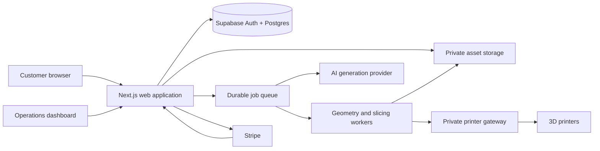

# PrintForge — Product Requirements Document

**Document status:** Build-ready MVP specification  
**Product type:** Direct-to-consumer AI-assisted 3D-printing service  
**Version:** 1.0  
**Last updated:** 19 July 2026

## 1. Executive summary

PrintForge lets a customer describe an object they want to 3D print, review an AI-generated model interactively, choose its physical print configuration, receive a manufacturing-aware quote, pay, and track delivery. The platform then validates the model, slices it for a configured printer, and routes it through an internal production queue.

The product is not a general-purpose CAD application. The first release is an AI-assisted custom-printing service for consumer-safe, non-engineering objects. It will show a **Technical Mesh View** of the generated 3D model, but it will not promise editable parametric CAD conversion.

## 2. Product vision

Turn an idea into a real, delivered object through a guided, trustworthy workflow:

> Describe it → see it in 3D → configure it for the real world → approve the quote → we print and deliver it.

The experience must make a complex manufacturing process feel creative and simple, while preserving the operational controls needed to avoid unprintable, unsafe, or underpriced orders.

## 3. Goals and success criteria

### Goals

1. Enable customers to create a printable 3D model from a plain-language description.
2. Give customers confident, accurate visual and physical preview controls before purchase.
3. Prevent unprintable designs from reaching a printer without review.
4. Produce a quote based on real manufacturing inputs, not an arbitrary flat price.
5. Give operations staff full control over approval, scheduling, quality assurance, and shipping.

### MVP success measures

- A signed-in customer can complete a prompt-to-order flow without staff help for straightforward designs.
- Every paid order has a saved design version, selected print profile, quote breakdown, and production status history.
- No printer is directly reachable from the public internet or browser.
- The app rejects or flags models that fail required printability checks.
- Quotes use slicer-derived material/time estimates before a production job is approved.

## 4. Target users

### Customer

An individual who wants a custom decorative, novelty, gift, or simple functional 3D-printed item but does not know CAD.

### Operations operator

A staff member who reviews exceptions, manages material inventory and printer profiles, approves jobs, monitors production, performs quality checks, and dispatches shipments.

### Administrator

An owner or manager who configures service regions, products/materials, pricing rules, user access, content restrictions, and operational integrations.

## 5. Scope

### MVP in scope

- Marketing landing page.
- Account creation, login, and saved projects.
- Prompt-led AI 3D generation with progress updates and version history.
- 360-degree interactive 3D model viewer.
- Users should be able to upload direct STL files for printing if they want to bypass the websites building tool and directly give their own model for printing. But the model feasibility checks should still be done on such upload files same as the models built within the website.
- Realistic visual mode and Technical Mesh View.
- Scale, material, color, quality, and strength selections.
- Automated printability analysis and human-review escalation.
- Slicer-backed price, material, and duration estimate.
- Checkout, delivery details, payment confirmation, order status, and order tracking.
- Private operations dashboard and controlled printer dispatch.
- One launch geography and a narrow set of printer/material profiles.

### Explicitly out of scope for MVP

- True editable parametric CAD or automatic conversion to AutoCAD/SolidWorks-style models.
- Precision-engineered parts requiring guaranteed tolerances.
- Full-color textured printing; website textures are a visual preview, not a promise of a physical color print.
- Fully unattended print start immediately after checkout.
- Marketplace for third-party sellers.
- Multi-region tax, currency, and delivery operations.
- Industrial materials, resin printing, metal printing, or large-format printing unless specifically configured for launch.

## 6. Key product decisions

1. **Start with FDM printing only.** It is suitable for a broad consumer MVP. Resin requires different handling, finish, safety, and support workflows.
2. **Treat AI generation as asynchronous.** The customer sees task status and is never left with a blocked interface.
3. **Use a provider adapter.** Meshy is the initial text-to-3D provider; the code must support adding Tripo or another provider later without changing the application workflow.
4. **Call the wireframe mode Technical Mesh View.** It is not CAD.
5. **Use an approval state after payment.** An order becomes printable only after automated checks and, where necessary, staff review.
6. **Base the final quote on slicing.** Mesh volume can provide a fast preview estimate but must not be the only source of truth.

## 7. Customer experience

### 7.1 Landing page

Purpose: explain the value proposition and move users into creation.

Required sections:

- Hero headline: "Describe it. See it. We print it."
- Prompt-style call to action: "What would you like to create?"
- Interactive or pre-rendered 3D model demo.
- Three-step explainer: Create → Preview → Delivered.
- Example objects and appropriate use cases.
- Materials/colors overview, starting-price guidance, FAQs, delivery-region notice, and trust/policy links.
- Calls to action for "Start creating" and "See examples."

### 7.2 Creator workspace

Layout: a responsive split interface. On desktop, the conversational creation panel is left and the 3D workspace is right. On mobile, the panels stack with the model viewer prioritized.

#### Creation panel

- Free-form prompt input.
- Guided follow-up fields or questions: intended use, approximate size, style, durability/strength, material preference, and color preference.
- Optional reference-image upload.
- Explicit submit/generate control.
- Generation status: queued, creating, ready, failed.
- Prompt/version history with the ability to reopen a previous version.
- Regenerate/refine action and a clear notice that each AI generation may have a cost or usage limit.

#### 3D workspace

- GLB model loading with progress/error states.
- Drag to rotate; scroll/pinch to zoom; pan where appropriate.
- Reset camera, fit to view, fullscreen, and screenshot/thumbnail actions.
- Lighting/environment controls appropriate to previewing the form.
- Toggle between Visual Mode and Technical Mesh View.
- Dimension readout, bounding box, axes, and selected physical scale.
- Accessible non-canvas controls for every essential action.

#### Visual Mode

- Physically based material preview.
- Material/color swatches tied only to actually available print profiles.
- Explain that on-screen surface textures may not reproduce on an FDM print.

#### Technical Mesh View

- Wireframe overlay or mesh-only render.
- Optional normals and bounding box display.
- Same rotation, zoom, and drag controls as Visual Mode.
- Simple warnings for mesh issues and a link to the printability report.

### 7.3 Print configuration and quote

Required customer choices:

- Physical dimensions in millimeters, with constrained slider/input.
- Material: initial options such as PLA and PETG, depending on actual operations.
- Filament color from available stock.
- Quality preset: standard or fine.
- Strength preset: display, everyday, or reinforced; maps to approved slicer/infill profiles.
- Shipping speed and special instructions.

Required quote display:

- Item price, material, estimated print duration, production estimate, shipping, taxes where applicable, and total.
- Expected delivery window.
- Quote expiry time.
- Printability state: ready, needs adjustment, or needs manual review.
- A clear explanation that approved orders may be refunded or re-quoted if a material operational issue is found.

### 7.4 Checkout and order tracking

Checkout must collect:

- Customer email and contact name.
- Shipping address, phone number where needed, and delivery preference.
- Shipping method.
- Special instructions.
- Payment using Stripe-hosted or embedded Checkout.

After payment, show an order confirmation with the finalized design thumbnail, configuration, invoice/receipt, and an initial status of **Paid — preparing for production**.

Customer-visible status flow:

`Paid → Design review → Queued → Printing → Quality check → Shipped → Delivered`

## 8. End-to-end operational workflow

1. Customer submits a prompt and optional reference image.
2. The application performs prompt moderation and converts the input into a structured design brief.
3. A background job submits generation to the AI provider and polls or receives a webhook for completion.
4. The service immediately copies the resulting model to private object storage; provider download URLs may expire.
5. The platform creates a viewer-friendly GLB and a print pipeline mesh such as STL or 3MF.
6. The geometry worker analyzes the model and produces a printability report.
7. The customer selects an approved material and print profile. The system scales, orients, and slices the model in an isolated worker.
8. The quote service uses slicer outputs—material mass, supports, estimated duration—and pricing rules to calculate the final price.
9. Customer checks out and payment webhooks update the order only after verified confirmation.
10. Automated approval passes print-ready jobs to the operations queue; exception jobs require staff review.
11. An operator chooses a printer/profile, releases the G-code through the private printer gateway, and monitors the job.
12. After quality check, the operator creates the shipment, adds a tracking number, and marks the order shipped.

## 9. Functional requirements

### FR-1 — Authentication and accounts

- Users can sign up, log in, log out, reset a password, and manage their profile.
- A user can view only their own projects, model files, orders, and addresses.
- Operations/admin roles are distinct from customer accounts.

### FR-2 — Project and design versioning

- A project represents one customer design journey.
- A project can contain multiple immutable design versions.
- Each version stores its prompt, structured brief, generation provider/task identifier, model asset references, validation results, and selected configuration.
- Placing an order freezes the selected version and configuration.

### FR-3 — AI generation

- The server, never the browser, stores and uses AI provider credentials.
- Generation requests are queued and rate limited per user.
- The UI receives status updates without exposing provider secrets.
- Failures must present a helpful retry option and preserve the prompt.
- The provider integration must normalize output into internal asset and task structures.

### FR-4 — 3D viewer

- Support GLB as the primary web-viewer format.
- Support orbit rotation, zoom, pan where useful, reset, fit-to-model, and fullscreen.
- Respect reduced-motion settings and remain usable by keyboard/screen-reader users through surrounding controls and descriptions.
- Render Visual Mode and Technical Mesh View without modifying the stored source mesh.

### FR-5 — Printability validation

- Validate maximum build volume against the selected printer profile.
- Detect non-manifold edges, holes, self-intersections, disconnected components, inverted normals, and invalid/empty geometry.
- Calculate bounding dimensions, volume, surface area, and component count.
- Evaluate material/profile-specific minimum wall thickness, sharp/thin features, unsupported overhangs, stability/base area, and trapped geometry where feasible.
- Produce a structured result: `pass`, `warning`, `manual_review`, or `fail`.
- Do not auto-repair silently. Display what was changed and preserve the original asset.

### FR-6 — Slicing and pricing

- Use approved versioned printer/material/quality profiles.
- Slice in an isolated job environment.
- Store the slicer version, profile version, orientation, supports, G-code reference, estimated time, material mass, and material length.
- Calculate price using configurable rules for material, machine time, supports, labor/handling, shipping, taxes, and failure allowance.
- Recalculate when size, material, quality, strength, shipping address, or delivery option changes.

### FR-7 — Checkout and payment

- Do not trust prices submitted by the client.
- Create Checkout sessions only from a server-calculated quote.
- Process payment events using verified Stripe webhooks and idempotency keys.
- Record payment, refund, and fulfillment state separately from user interface state.
- Capture/address and shipping data according to the intended sales geography and applicable law.

### FR-8 — Operations dashboard

- List/filter orders by state, printer, material, due date, and exception reason.
- Review and approve/reject/hold a job with an auditable reason.
- View the model, validation report, selected profile, pricing, G-code metadata, and order notes.
- Assign printer, schedule print, retry failed jobs, cancel safely, and record quality-check outcome.
- Add tracking and customer-facing status updates.

### FR-9 — Printer gateway

- The web application must never expose printer access tokens or direct printer network endpoints.
- A private service only accepts signed, authorized jobs from the backend.
- It uploads G-code, obtains printer/job status, and records events.
- It must handle unavailable/busy printers, duplicate release attempts, safety interlocks, and job cancellation.

### FR-10 — Notifications

- Send transactional email for order receipt, review hold, production milestone, shipment, cancellation/refund, and delivery tracking.
- Notify operations of manual-review and print-failure events.
- Provide a notification log per order.

## 10. Non-functional requirements

### Security and privacy

- Use row-level access controls and private object storage with short-lived signed URLs.
- Encrypt secrets in managed secret storage; do not place secrets in browser bundles.
- Rate-limit authentication, generation, and upload endpoints.
- Validate upload type/size and scan uploads before processing.
- Maintain audit records for payment, approval, printer release, and refund events.
- Collect only necessary personal data and define retention/deletion rules.

### Reliability

- Every asynchronous job must be idempotent and retry-safe.
- Use durable job queues and dead-letter/error handling.
- Record external provider request IDs and status transitions.
- Display graceful status/error states for AI generation, 3D loading, quoting, checkout, and printer operations.

### Performance

- Landing page should load quickly and defer large 3D assets.
- Use model compression and progressive loading for viewer assets.
- Cache thumbnails and derived viewer files.
- Run long generation, validation, and slicing work outside the web request lifecycle.

### Accessibility and mobile

- Meet WCAG 2.2 AA for application UI outside the canvas.
- Provide keyboard alternatives and text descriptions for canvas controls.
- Support current mobile browsers for prompt, account, checkout, and basic 3D viewing.

## 11. Suggested technical architecture

### Frontend

- **Next.js (App Router) + TypeScript** for the landing page, authenticated application, APIs/BFF layer, and operational dashboard.
- **Tailwind CSS** and a consistent accessible component system.
- **React Three Fiber, Drei, and Three.js** for the 3D workspace.

### Core platform

- **Supabase** for authentication, PostgreSQL, row-level security, and initial private asset storage.
- **Python/FastAPI services** for geometry validation, repair proposals, conversion, slicing orchestration, and printer integration.
- **Redis + Celery** or an equivalent durable queue for asynchronous generation and production jobs.
- Deploy the Next.js app independently from containerized worker services so heavy geometry work cannot exhaust web resources.

### External services

- **Meshy API** as the initial text-to-3D provider, behind a provider adapter. Its current workflow supports a fast geometry preview and a later texture/refinement step, with model formats including GLB, STL, and 3MF. [Meshy Text-to-3D API](https://docs.meshy.ai/en/api/text-to-3d)
- **Stripe Checkout Sessions** for payments, shipping addresses, receipts, and payment lifecycle webhooks. Stripe recommends Checkout Sessions for most flows because it includes more commerce capabilities with less bespoke maintenance than direct Payment Intents. [Stripe Checkout Sessions vs. Payment Intents](https://docs.stripe.com/payments/checkout-sessions-and-payment-intents-comparison)
- **OctoPrint or Moonraker** behind a private gateway, selected to match the actual printer firmware. OctoPrint supports controlled G-code file upload and print actions through its API. [OctoPrint File API](https://docs.octoprint.org/en/main/api/files.html)

### System boundary diagram

## 12. Core data model

| Entity | Purpose | Key fields |
|---|---|---|
| User | Customer, operator, or admin identity | id, role, name, email |
| Project | Customer design container | id, user_id, title, status |
| DesignVersion | Immutable generated/revised model | id, project_id, prompt, brief_json, model_asset_id, provider_task_id |
| Asset | Private source/derived file | id, type, storage_key, checksum, mime_type, source_asset_id |
| ValidationReport | Printability results | design_version_id, profile_id, state, findings_json, measurements_json |
| PrintConfiguration | Selected physical print parameters | design_version_id, material_id, color_id, dimensions_mm, quality_profile_id, strength_profile_id |
| Quote | Server-calculated price | id, config_id, amount, currency, calculation_json, expires_at |
| Order | Commercial fulfillment record | id, user_id, quote_id, status, shipping_address_id, payment_state |
| PrintJob | Manufacturing/slicing record | order_id, printer_profile_id, gcode_asset_id, orientation, slicer_metadata, status |
| Printer | Physical device state | id, gateway_id, capabilities, current_state |
| Shipment | Delivery record | order_id, carrier, tracking_number, status |
| AuditEvent | Immutable operational history | actor_id, entity_type, entity_id, action, metadata, created_at |

## 13. API and event expectations

All APIs must be authenticated where customer data is involved. Public endpoints must be rate-limited.

### Customer-facing API examples

- `POST /api/projects` — create a project.
- `POST /api/projects/{id}/generations` — enqueue a generation request.
- `GET /api/generations/{id}` — read normalized generation status.
- `POST /api/design-versions/{id}/configuration` — save selected print configuration.
- `POST /api/design-versions/{id}/quote` — request/recalculate a server quote.
- `POST /api/checkout/session` — create Stripe checkout from a valid quote.
- `GET /api/orders/{id}` — view order and customer-safe status history.

### Internal API examples

- `POST /internal/validation/{designVersionId}` — run/queue geometry analysis.
- `POST /internal/slicing/{configurationId}` — create a slicer run.
- `POST /internal/orders/{orderId}/approve` — approve a manufacturing job.
- `POST /internal/print-jobs/{id}/release` — release an approved G-code job to the printer gateway.
- `POST /webhooks/stripe` — verified payment and refund events.
- `POST /webhooks/generation-provider` — optional AI provider completion events.

### Required domain events

- `generation.requested`, `generation.completed`, `generation.failed`
- `asset.ingested`, `validation.completed`, `validation.failed`
- `quote.created`, `quote.expired`
- `payment.succeeded`, `payment.refunded`
- `order.review_requested`, `order.approved`, `order.rejected`
- `print_job.queued`, `print_job.started`, `print_job.failed`, `print_job.completed`
- `shipment.created`, `shipment.delivered`

## 14. Content, safety, and policy requirements

- Moderate prompts and reference uploads before generation.
- Define prohibited-design categories before launch, including weapons/weapon components, regulated items, illegal goods, hateful material, and content that infringes known third-party intellectual property.
- Publish user terms covering uploaded content ownership, AI-output limitations, acceptable use, cancellation/refund policy, and the physical variation inherent in 3D printing.
- Add a manual-review route for ambiguous or higher-risk requests.
- Never state that a model is structurally safe for a critical use case without a dedicated engineering process.

## 15. Acceptance criteria for the MVP

### Creation and preview

- A new authenticated user can submit a prompt, see generation progress, and open the completed model in the viewer.
- The model can be rotated 360 degrees, zoomed, reset, and viewed in both Visual Mode and Technical Mesh View.
- A user can change size/material/color/quality and clearly see the configuration used for pricing.

### Manufacturing readiness

- The system stores original and derived assets privately and persistently.
- Every configured model gets a validation report.
- An order cannot be released to a printer unless it has a successful payment state, a valid quote, a successful or operator-approved validation state, and approved G-code.
- Every slice is traceable to an exact design version, dimensions, material, printer profile, and slicer profile.

### Commerce and operations

- Checkout uses a server-created Stripe session and verified webhooks.
- A customer can view their order status and shipment tracking after purchase.
- An operator can review/hold/approve an order, assign a printer, release a job, and record shipment tracking.
- No browser user can access a printer endpoint or API key.

## 16. Implementation roadmap

### Phase 0 — Decisions and technical proof

- Confirm launch country/region, target customer, printer hardware, FDM material set, supported build sizes, shipping model, and currency.
- Test the selected AI provider with a representative prompt suite.
- Test geometry validation and slicing against real printer profiles.
- Define printability thresholds, pricing model, content rules, and refund/exception policy.

### Phase 1 — Product shell

- Build the landing page, authentication, customer projects, and responsive creator-workspace shell.
- Implement a mock viewer/model flow using bundled sample GLB assets.
- Build initial design system and accessibility foundations.

### Phase 2 — Generation and assets

- Integrate the provider adapter and Meshy implementation.
- Implement asynchronous job tracking, private asset storage, model conversion, thumbnails, and design versioning.
- Add prompt moderation and structured design-brief extraction.

### Phase 3 — Print configuration and quote

- Build configuration controls, Technical Mesh View, geometry analysis, slicer workers, and pricing engine.
- Expose clear printability and quote states in the customer UI.

### Phase 4 — Checkout and operations

- Integrate Stripe checkout and webhooks.
- Build the operations dashboard, approval workflow, printer gateway, job monitoring, and shipping updates.

### Phase 5 — Controlled launch

- Run internal test orders end-to-end.
- Launch to a limited customer cohort and review conversion, generation quality, quote accuracy, print failures, and support volume.
- Expand materials, printers, and service areas only after operational targets are met.

## 17. Post-MVP opportunities

- Image-to-3D from sketches and product photos.
- AR preview at home using USDZ/GLB.
- Customer-uploaded STL/3MF printing.
- Paid human design-concierge and real CAD redesign service.
- Multiple model variants and collaborative project sharing.
- B2B bulk quotations and organization accounts.
- Material sample packs, reorders, referrals, gift cards, and subscriptions.
- Automated print photos, production video, and quality-check evidence.

## 18. Decisions required before implementation

The builder must ask for or use the following values before enabling real commerce and printing:

1. Launch geography, currency, tax responsibilities, and delivery carrier.
2. Customer segment: consumers, businesses, or both.
3. Actual printer fleet, firmware, build volumes, nozzle sizes, and supported materials/colors.
4. Whether operations uses OctoPrint, Moonraker/Klipper, or another printer-management system.
5. Initial material catalog, minimum wall requirements, approved slicer profiles, and fulfillment SLAs.
6. AI-provider account, budget/credit limits, and generation rate limits.
7. Brand name, visual identity, domain, customer support channels, and legal/policy text.

## 19. Instructions for an AI builder

Use this PRD as the implementation specification. Build the MVP in the order listed in Section 16. Do not replace the manufacturing workflow with mocked claims when production integrations are enabled. Where a required business value is unknown, isolate it in a typed configuration file, seed data, or environment variable and label it clearly for the owner.

Prioritize a polished landing page and creator experience, but implement security, private file access, quote integrity, order states, and the operations dashboard as first-class requirements. Do not expose AI, payment, or printer secrets to the client. Treat printer dispatch as a privileged backend workflow with explicit approval and audit logging.

Use realistic sample model assets and mocked worker states until valid provider, Stripe, and printer credentials are supplied. Include unit tests for pricing/state transitions, integration tests for webhook idempotency, and end-to-end tests for the core prompt-to-order workflow.
